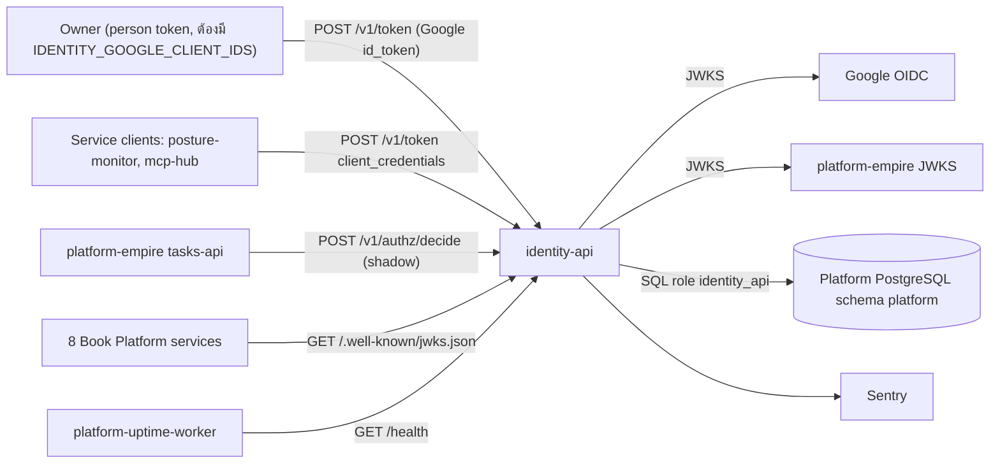
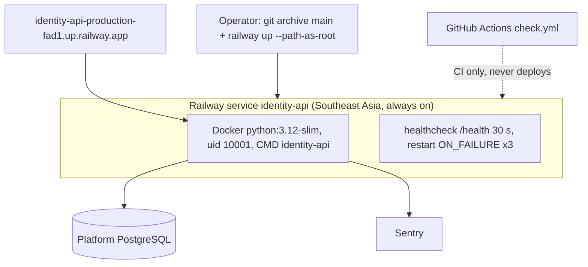

# Book Identity Platform — System Architecture

เอกสารนี้สรุปสถาปัตยกรรมของ `identity-api` จากโค้ดและ config ใน repo (ณ `origin/main` `d76a10c`, 2026-11-04) รายละเอียดเชิงลึกอยู่ใน Core 22 diagram pack [`docs/diagrams/`](../docs/diagrams/README.md); เอกสารนี้ไม่คัดลอก แต่ลิงก์ไป
ข้อเท็จจริงที่ไม่อยู่ใน repo อ้าง `ops record: book-platforms-status (2026-11-03)` หรือ `ops record: api-gateway-edge (2026-11-03)`

หมายเหตุ tier: `docpack.yaml` ยังเป็น `tier: L0` และ `00-product-card.md` (2026-10-08) ยังบอกว่า "ยังไม่มี runtime" ซึ่งล้าหลังโค้ดปัจจุบัน; เอกสารนี้ไม่เปลี่ยน tier

## 1. Architecture style และเหตุผล

- **Single-purpose service (modular monolith ขนาดเล็ก)**: process เดียว FastAPI ทำ 4 งาน: token exchange (Google id_token → access token), `client_credentials` สำหรับ service clients, เผยแพร่ JWKS/discovery และ `POST /v1/authz/decide`
- **Strangler + shadow**: identity ถูกแยกออกจาก `platform-empire` ทีละขั้น (design §7 ขั้น 0–8); `authz/decide` default เป็นโหมด `shadow` ที่ rollback transaction จึงเทียบคำตอบกับ platform ได้โดยไม่มีผลข้างเคียง ([ADR-0001](../docs/diagrams/08-adr/ADR-0001-python-fastapi-shadow-service.md))
- **Token issuer แบบ stateless verify**: ผู้ตรวจ (8 platform services) ตรวจ token ด้วย JWKS เอง ไม่ต้องเรียก identity ทุก request ([ADR-0003](../docs/diagrams/08-adr/ADR-0003-own-rs256-issuer-and-jwks.md))
- เหตุผลรวม: ลด login ที่ซ้ำ 3 แบบและ allowlist หลายที่ให้เหลือ issuer เดียว (`docs/DESIGN-2026-10-13.md` §1) โดยไม่ต้องย้าย DB ก่อน

## 2. Quality-attribute scenarios

| ID | Attribute | Scenario (stimulus → response) | กลไกที่มีในโค้ด | หลักฐาน |
|---|---|---|---|---|
| QA-01 | Security | token ที่ audience/issuer ผิด ถูกส่งเข้า `authz/decide` → ปฏิเสธ | `TokenVerifier` ตรวจ `iss`, `aud`, lifetime | `auth.py`, `test_rejects_tokens_for_another_audience_or_issuer` |
| QA-02 | Security / privacy | คนที่ไม่รู้จักและคนที่ไม่ใช่สมาชิกขอ token → คำตอบเดียวกัน `invalid_grant` | query เดียว + ข้อความเดียว | `app.py` `token`, `test_token_exchange_refusals` |
| QA-03 | Security | assertion ของ service client ถูก replay → ครั้งที่สองถูกปฏิเสธ | `ReplayCache` จำ `jti` จนหมดอายุ | `service_clients.py`, `test_an_assertion_is_used_once` |
| QA-04 | Availability | JWKS ของ Google/platform ล่มชั่วคราว → ใช้ key ชุดล่าสุดที่ดีต่อ | `RemoteJwks` cache 600 s | `keys.py`, `test_jwks_outage_keeps_the_last_good_keys` |
| QA-05 | Availability | platform DB ล่ม → `client_credentials` ยังออก token ได้ (ไม่แตะ DB); `/readyz` ตอบ 503 แบบ generic | registry อยู่ใน env | `docs/SERVICE-CLIENTS.md`, `app.py` `/readyz` |
| QA-06 | Abuse resistance | ยิง `/v1/token` ถี่ → ถูก rate limit ตาม proxy hop สุดท้าย | `RateLimiter` (local) หรือ `PostgresRateLimiter` | `rate_limit.py`, `test_token_endpoint_is_rate_limited_by_the_last_proxy_hop` |
| QA-07 | Correctness | shadow decide ต้องตอบเหมือน `platform.authorize` และไม่บันทึก | rollback ใน `bound` | `test_shadow_decide_answers_like_the_platform_and_records_nothing` |

เป้าหมายตัวเลข (latency, uptime %) ยังไม่ได้กำหนดใน repo: ดู Open questions

## 3. Context diagram

ภาพเต็มพร้อม Sources: [05-c4-context.md](../docs/diagrams/05-c4-context.md)

Edge gateway (`gateway.bookchaowalit.com`) **ไม่** มี route ไป identity: `routes.json` ของ platform-api-gateway @ `4a31ff5` ไม่มี key ของ identity และ ops record ระบุว่า generator ข้าม identity; ทุกการเรียก identity จึงเป็น direct ไปที่ `https://identity-api-production-fad1.up.railway.app`

## 4. Components / containers

ภาพ: [06-c4-container.md](../docs/diagrams/06-c4-container.md), [07-c4-component.md](../docs/diagrams/07-c4-component.md)

| Container / component | เทคโนโลยี | หน้าที่ | หลักฐาน |
|---|---|---|---|
| `identity-api` (process) | Python 3.12 image, FastAPI, uvicorn | entry `platform_identity.app:main`, port 8080 | `Dockerfile`, `pyproject.toml` `[project.scripts]` |
| `app.py` | FastAPI routes | `/health`, `/readyz`, `/.well-known/jwks.json`, `/.well-known/openid-configuration`, `POST /v1/authz/decide`, `POST /v1/token` | `src/platform_identity/app.py` |
| `auth.py` `TokenVerifier` | PyJWT | ตรวจ platform bearer token ของผู้เรียก decide | `auth.py` |
| `google.py` `GoogleVerifier` | PyJWT | ตรวจ Google id_token → `google:` | `google.py` |
| `service_clients.py` | PyJWT | parse registry, ตรวจ `private_key_jwt`, `ReplayCache` | `service_clients.py` |
| `keys.py` | cryptography, httpx | `SigningKey` (RS256 + `kid`), `RemoteJwks`, `decode_with_any` (รองรับ token ที่ไม่มี `kid`) | `keys.py` |
| `rate_limit.py` | psycopg_pool | local / Postgres rate limiter, `apply_migration` | `rate_limit.py`, `migrations/0001_token_rate_limit.sql` |
| `config.py` | env | อ่าน `IDENTITY_*`, บังคับ issuer HTTPS และต่างจาก platform issuer | `config.py` |
| `_sentry.py` | sentry-sdk | init เมื่อมี `SENTRY_DSN`, scrub ด้วย regex | `_sentry.py`, `tests/service/test_sentry.py` |
| `identity-rate-limit-migrate` | Python CLI | migration ของ schema `identity_rate_limit` รันด้วยมือ ไม่รันตอน startup | `pyproject.toml`, `rate_limit.py` `main` |

## 5. Tech stack

| ชั้น | เทคโนโลยี | หลักฐาน |
|---|---|---|
| Runtime | Python ≥ 3.11 (image 3.12-slim, user uid 10001) | `pyproject.toml`, `Dockerfile` |
| Web | FastAPI < 1, uvicorn[standard] | `pyproject.toml` |
| Crypto / JWT | pyjwt[crypto] (RS256) | `pyproject.toml`, `keys.py` |
| DB client | psycopg[binary,pool] 3 | `pyproject.toml` |
| HTTP client | httpx (JWKS fetch) | `keys.py` |
| Observability | sentry-sdk ≥ 2.72 | `_sentry.py` |
| CI | platform-ci-workflows `ci-python.yml` / `security.yml` @ `87dc5e1c` (v1.1.1) | `.github/workflows/check.yml` |

**ความสัมพันธ์กับ `platform-backend-core`**: identity **ไม่** ใช้ core ใน runtime (ไม่มีใน `dependencies` และ Dockerfile ไม่ติดตั้ง) ต่างจาก 8 platform services ที่ pin core เป็น runtime dependency; identity ใช้ core เฉพาะ extra `postgres-test` ที่ pin commit `85b066fa` (Python ≥ 3.12) สำหรับ `runtime_tests/test_rate_limit.py` (`temporary_database`, และตรวจว่า token ของ identity ผ่าน `TokenVerifier`/`require_scope` ของ core) และอ้าง core เป็นที่อยู่ canonical ของ contract schema (`README.md`, `scripts/check_schema_pin.py`)

## 6. Data stores

| Store | ข้อมูล | เจ้าของ schema | หลักฐาน |
|---|---|---|---|
| Platform PostgreSQL schema `platform` | identities, workspaces, memberships, roles, policies, delegations, `platform.authorize()` | platform-empire (migration 0008 สร้าง role `identity_api`) | [ADR-0004](../docs/diagrams/08-adr/ADR-0004-shared-platform-db-rls-role.md), `docs/DESIGN-2026-10-13.md` §4 |
| schema `identity_rate_limit` (optional, โหมด postgres) | windows, schema_migrations | repo นี้ | `migrations/0001_token_rate_limit.sql`, `docs/SHARED-RATE-LIMIT.md` |
| In-process | rate limiter (โหมด local), `ReplayCache`, JWKS cache | — | `app.py`, `service_clients.py`, `keys.py` |
| Railway variables | signing key, service client registry (public keys เท่านั้น) | owner | `railway.toml` comment, `config.py` |

ERD: [09-erd.md](../docs/diagrams/09-erd.md). ไม่เก็บรหัสผ่าน (`PRODUCT.md`)

## 7. Integrations

| ระบบ | ทิศทาง | ใช้ทำอะไร | สถานะ | หลักฐาน |
|---|---|---|---|---|
| Google OIDC | identity → Google | ดึง JWKS ตรวจ id_token | โค้ดพร้อม; production ปฏิเสธทุก Google token เพราะ `IDENTITY_GOOGLE_CLIENT_IDS` ยังไม่ตั้ง | `google.py`, `docs/PLATFORM-SERVICES-CUTOVER.md` |
| platform-empire | สองทาง | identity ดึง platform JWKS (`IDENTITY_PLATFORM_JWKS_URL`); platform เรียก decide แบบ shadow | live | `config.py`, `app.py` |
| 8 Book Platform services | services → identity | ดึง JWKS; `JWT_ISSUER` = identity URL, audience `<svc>-api` | live ตั้งแต่ 2026-10-29 (security 2026-11-02) | ADR-0003, ops record |
| Service clients (`posture-monitor`, `mcp-hub`) | client → identity | `client_credentials` + `private_key_jwt` | live 2026-11-03 | [ADR-0005](../docs/diagrams/08-adr/ADR-0005-service-clients-private-key-jwt.md), cutover doc |
| Neon | identity → DB | `IDENTITY_DATABASE_URL` (pool max 8) | live | `app.py`, 06 |
| Sentry | identity → Sentry | error events | regex scrub (ยังไม่ใช่ "no free text" แบบ 8 services) | `_sentry.py`, diagrams README findings |
| Edge gateway | — | ไม่มี route | by design (ops record) | platform-api-gateway `routes.json` @ `4a31ff5` |
| R2 / Queues / Kafka | — | ไม่ใช้ | not applicable: ไม่มีโค้ดเรียก | `src/` |

## 8. Deployment topology

ภาพเต็ม: [16-deployment.md](../docs/diagrams/16-deployment.md)

- Deploy ด้วย CLI เท่านั้น (Railway GitHub app ไม่ได้ติดตั้งใน org: comment ใน `check.yml`) ([ADR-0006](../docs/diagrams/08-adr/ADR-0006-railway-cli-deploy-singapore.md))
- always on ต่างจาก 8 services ที่ sleep (`railway.toml` comment)
- ตัวแปร (ชื่อเท่านั้น): `IDENTITY_DATABASE_URL`, `IDENTITY_SIGNING_KEY_PEM`, `IDENTITY_ISSUER`, `IDENTITY_PLATFORM_ISSUER`, `IDENTITY_PLATFORM_JWKS_URL`, `IDENTITY_GOOGLE_CLIENT_IDS`, `IDENTITY_TOKEN_AUDIENCES`, `IDENTITY_SHARED_SCOPE_PERMISSIONS_JSON`, `IDENTITY_SERVICE_CLIENTS_JSON`, `IDENTITY_DECIDE_MODE`, `IDENTITY_RATE_LIMIT_*`, `SENTRY_DSN`, `SENTRY_ENVIRONMENT` (รายการเต็ม: 16-deployment)

## 9. ADR สำคัญ

| ID | การตัดสินใจ | ไฟล์ |
|---|---|---|
| ADR-0001 | Python/FastAPI shadow service ข้าง platform-empire (strangler) | [ADR-0001](../docs/diagrams/08-adr/ADR-0001-python-fastapi-shadow-service.md) |
| ADR-0002 | Google OIDC, ไม่เก็บรหัสผ่าน, subject `google:` | [ADR-0002](../docs/diagrams/08-adr/ADR-0002-google-oidc-no-passwords.md) |
| ADR-0003 | RS256 issuer + JWKS ของตัวเอง, `kid` = RFC 7638 thumbprint | [ADR-0003](../docs/diagrams/08-adr/ADR-0003-own-rs256-issuer-and-jwks.md) |
| ADR-0004 | ใช้ DB ของ platform-empire ผ่าน role `identity_api` + RLS | [ADR-0004](../docs/diagrams/08-adr/ADR-0004-shared-platform-db-rls-role.md) |
| ADR-0005 | Service clients `client_credentials` + `private_key_jwt`, registry ใน env | [ADR-0005](../docs/diagrams/08-adr/ADR-0005-service-clients-private-key-jwt.md) |
| ADR-0006 | Railway Singapore always on, deploy ด้วย CLI, CI ไม่ deploy | [ADR-0006](../docs/diagrams/08-adr/ADR-0006-railway-cli-deploy-singapore.md) |

## 10. Fitness functions (สิ่งที่ guard สถาปัตยกรรมอยู่แล้ว)

| Guard | ตรวจอะไร | ที่อยู่ |
|---|---|---|
| Contract check | `contract.json` ตรง schema และ README ตรง `CONTRACT-SURFACE.md` | `scripts/check.py`, job `service` ใน `check.yml` |
| Schema pin | schema ที่ vendored ตรง sha256 pin และ canonical | `scripts/check_schema_pin.py`, `tests/test_drift_checks.py` |
| Registry alignment | contract ตรงกับ registry ของ solo-empire | `scripts/check_registry_alignment.py`, `tests/test_drift_checks.py` |
| Service tests (3.11 + 3.12) | token exchange, shadow parity, JWKS publish only public key, service clients, Sentry scrub | `tests/service/`, matrix ใน `check.yml` |
| Admission tests (Postgres จริง) | shared rate limit + token ของ identity ผ่าน verifier ของ core | `runtime_tests/test_rate_limit.py`, job `admission` |
| Lint / type | ruff rule set ตายตัว, mypy บน `src/` | `pyproject.toml`, `check.yml` |
| Security baseline | workflow `security.yml` ร่วม (SHA-pinned) | job `security` |

ไม่มี coverage gate และ CI ไม่ build Docker image (ต่างจาก security/communication)

## 11. เอกสารลงรายละเอียด phase 07

| Template | สถานะ | ไฟล์ / เหตุผล |
|---|---|---|
| `sdlc/infrastructure-and-network-design.md` | partial (ภาพ, ไม่ใช่ template) | [16-deployment.md](../docs/diagrams/16-deployment.md), [19-service-dependency-map.md](../docs/diagrams/19-service-dependency-map.md) |
| `sdlc/observability-design.md` | partial | [20-observability.md](../docs/diagrams/20-observability.md); ไม่มี SLO |
| `sdlc/capacity-performance-and-cost-plan.md` | missing | ยังไม่มี workload model หรือ load test |
| `sdlc/failure-mode-analysis.md` | partial | [13-threat-model.md](../docs/diagrams/13-threat-model.md), [14-backup-dr.md](../docs/diagrams/14-backup-dr.md), [21-incident-response.md](../docs/diagrams/21-incident-response.md) |
| `sdlc/async-integration-contract.md` | not_applicable | ไม่มี queue, event, webhook หรือ scheduled job ใน `src/` |
| `sdlc/frontend-architecture.md` | not_applicable | API อย่างเดียว ไม่มี UI (`/docs` ปิด) |
| `sdlc/tech-debt-register.md` | missing | รายการ debt อยู่ใน findings ของ [diagrams README](../docs/diagrams/README.md) |
| `operations/system-landscape.md` | external | ต้องมีแถวใน landscape กลางของ architecture-docs (ไม่ได้ตรวจในงานนี้) |
| `development-cycle/vendor-dependency-review.md` | missing | Railway, Neon, Google, Sentry ยังไม่มี lock-in/exit review |

## Open questions

- เป้าหมาย latency / availability ของ `/v1/token` และ JWKS ยังไม่กำหนด ทั้งที่ 8 services ขึ้นกับ issuer นี้
- `IDENTITY_RATE_LIMIT_MODE` ใน production เป็น `local` หรือ `postgres` (06)
- Neon project ที่ `IDENTITY_DATABASE_URL` ชี้ (design บอก DB ของ platform-empire; ยืนยันจาก repo ไม่ได้)
- ทำไม identity เป็น always on ขณะที่ services อื่น sleep: ไม่มีบันทึกเหตุผล
- จะย้าย Sentry ไปเป็น "no free text" แบบ 8 services หรือไม่
- uptime probe ใช้ `/health` ซึ่งตอบ 200 แม้ DB ล่ม: ควรเปลี่ยนเป็น `/readyz` หรือไม่
- การหมุน signing key (JWKS มี key เดียว) และ replay cache แบบ shared ก่อนเพิ่ม replica

## การอนุมัติ

| บทบาท | สถานะ | วันที่ | ลงนาม |
|---|---|---|---|
| Solution Architect (Book Dev) | รอตรวจ | — | [ต้องยืนยัน] |
| Owner | รอตรวจ | — | [ต้องยืนยัน] |

## แหล่งข้อมูล

อ่านที่ `origin/main` `d76a10c790cba8bd6a3fc5aceab0b7280b4b4376` (2026-11-04):

- `pyproject.toml`, `Dockerfile`, `railway.toml`, `.github/workflows/check.yml`, `README.md`, `PRODUCT.md`, `contract.json`, `DOCPACK/docpack.yaml`, `DOCPACK/00-product-card.md`
- `src/platform_identity/app.py`, `auth.py`, `google.py`, `keys.py`, `service_clients.py`, `rate_limit.py`, `config.py`, `_sentry.py`, `migrations/0001_token_rate_limit.sql`
- `tests/service/test_app.py`, `test_service_clients.py`, `test_sentry.py`, `tests/test_drift_checks.py`, `runtime_tests/test_rate_limit.py`
- `docs/DESIGN-2026-10-13.md`, `docs/SERVICE-CLIENTS.md`, `docs/PLATFORM-SERVICES-CUTOVER.md`, `docs/SHARED-RATE-LIMIT.md`, `docs/diagrams/` (README, 05, 06, 07, 16, 08-adr/*)
- platform-api-gateway `routes.json` @ `4a31ff5` (ไม่มี route identity)
- ops record: book-platforms-status (2026-11-03), ops record: api-gateway-edge (2026-11-03)
