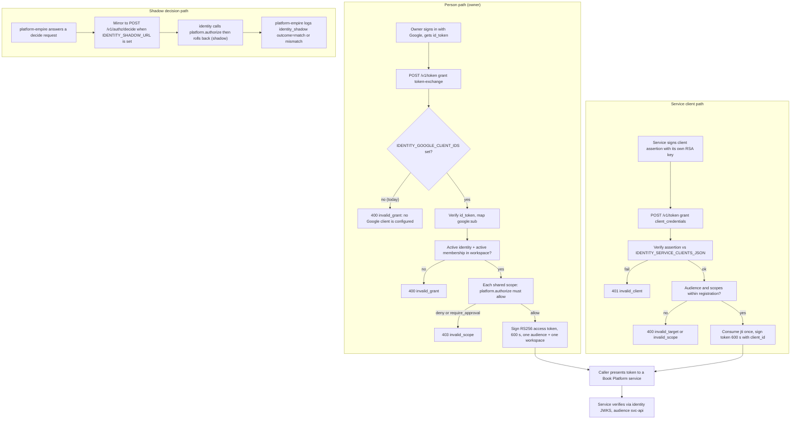
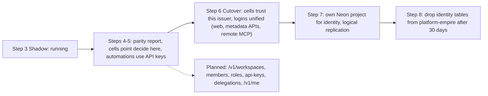

# 01 — Business process (As-Is / To-Be)

platform-identity เป็น backend platform service ไม่มี UI ผู้ใช้คนเดียวคือ owner (single-owner platform, `PRODUCT.md`)
"business process" ของ repo นี้จึงเป็นกระบวนการ **ออก token และตัดสินสิทธิ์** ให้ service อื่นใน Book Platform

## As-Is (จากโค้ดและ docs ณ `origin/main` `9bf770c`, 2026-11-03)

Sources: `src/platform_identity/app.py`, `src/platform_identity/google.py`, `src/platform_identity/service_clients.py`, `README.md`, `PRODUCT.md`, `docs/PLATFORM-SERVICES-CUTOVER.md`, `docs/SERVICE-CLIENTS.md`, ops record: book-platforms-status (2026-11-03) ("Only open: owner `IDENTITY_GOOGLE_CLIENT_IDS`")

ข้อสังเกต As-Is:
- person path ยังปิดอยู่จริงในวันนี้: `GoogleVerifier.external_subject` โยน `InvalidIdToken("no Google client is configured")` เมื่อไม่มี client id และ cutover doc ระบุว่า owner ยังไม่ได้ตั้ง `IDENTITY_GOOGLE_CLIENT_IDS`
- service client path ใช้งานจริงแล้ว: `posture-monitor` → `security-api` (2026-11-03) และ `mcp-hub` (ops record)
- cells เดิม (life-*, finance-*) ยังเชื่อ issuer `empire-platform` ไม่ใช่ issuer นี้ (`docs/PLATFORM-SERVICES-CUTOVER.md` "Not covered yet")

## To-Be (จาก `docs/DESIGN-2026-10-13.md`, `PRODUCT.md` roadmap, `docs/UPGRADE-PLAN.md`)

Sources: `docs/DESIGN-2026-10-13.md` §6–§7, `PRODUCT.md` (Roadmap), `contract.json` (`identity.http.workspace-admin` planned)

## Open questions

- Shadow parity gate (100% match ถึง 2026-10-21) ผ่านหรือไม่: `PRODUCT.md` บอก "log line exists; no report yet" ไม่มีรายงานใน repo
- ขั้น 4–5 ยังเป็น `[ต้องยืนยัน]` ใน `PRODUCT.md`; ลำดับจริงเมื่อเทียบกับการที่ 8 platform services เชื่อ issuer นี้ไปก่อนแล้ว (2026-10-29) ยังไม่มีเอกสาร To-Be ที่อัปเดต
- API keys (`emp_<prefix>_<secret>`) ใน design ยังไม่มีโค้ด ยังอยู่ในแผนหรือถูกแทนด้วย service clients
