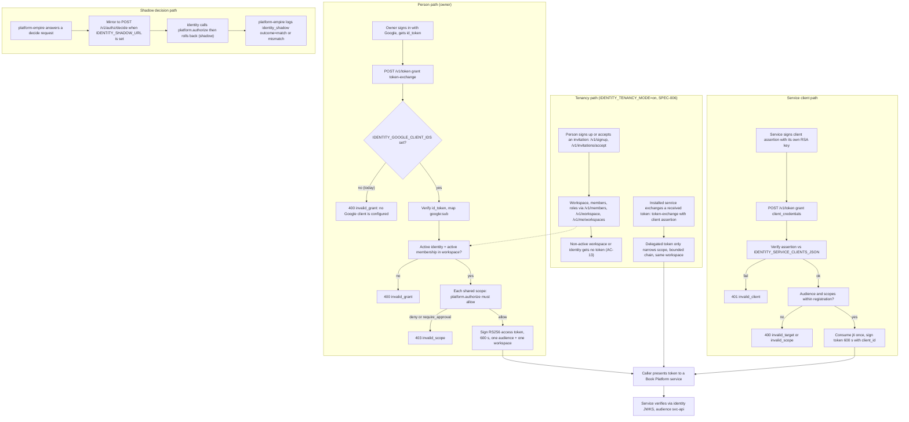
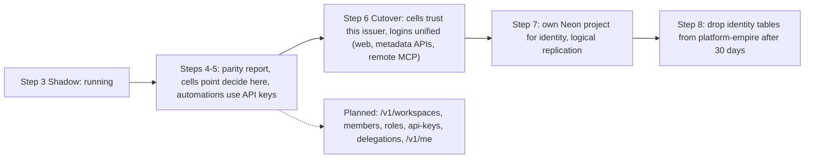

# 01 — Business process (As-Is / To-Be)

platform-identity เป็น backend platform service ไม่มี UI ผู้ใช้คนเดียวคือ owner (single-owner platform, `PRODUCT.md`)
"business process" ของ repo นี้จึงเป็นกระบวนการ **ออก token และตัดสินสิทธิ์** ให้ service อื่นใน Book Platform

Last reviewed: 2026-11-27 · commit `af6bef9`

## As-Is (จากโค้ดวันนี้)

Sources: `src/platform_identity/app.py`, `src/platform_identity/tenancy.py`, `src/platform_identity/config.py`, `docs/SPEC-006-TENANCY-AND-DELEGATION.md`, `src/platform_identity/google.py`, `src/platform_identity/service_clients.py`, `README.md`, `PRODUCT.md`, `docs/PLATFORM-SERVICES-CUTOVER.md`, `docs/SERVICE-CLIENTS.md`, ops record: book-platforms-status (2026-11-03) ("Only open: owner `IDENTITY_GOOGLE_CLIENT_IDS`")

ข้อสังเกต As-Is:
- person path เปิดแล้วตั้งแต่ 2026-11-28: `IDENTITY_GOOGLE_CLIENT_IDS` มี client `finance-suite-web` (ก่อนหน้านั้น `GoogleVerifier.external_subject` โยน `InvalidIdToken("no Google client is configured")`); ยังไม่มี login จริงบน production
- service client path ใช้งานจริงแล้ว: `posture-monitor` → `security-api` (2026-11-03) และ `mcp-hub` (ops record)
- tenancy path (`/v1/signup`, `/v1/members`, `/v1/invitations`, `/v1/workspace`, `/v1/me/workspaces`, `/v1/installations`, `/v1/service/installations`) และ delegated token มีในโค้ดแล้ว แต่ทำงานเมื่อ `IDENTITY_TENANCY_MODE=on` เท่านั้น (ค่าเริ่มต้น `off`) และ signup เริ่มต้นเป็น `closed` (`IDENTITY_SIGNUP_MODE`); ค่าบน production ตอนนี้ [ต้องยืนยัน]
- มี `/v1/internal/entitlement` ด้วย (`src/platform_identity/entitlement.py`) [ต้องยืนยัน] ว่าใครเรียกและ gate อะไร
- cells เดิม (life-*, finance-*) ยังเชื่อ issuer `empire-platform` ไม่ใช่ issuer นี้ [ต้องยืนยัน] ว่ายังจริงหลัง 2026-11-03 (`docs/PLATFORM-SERVICES-CUTOVER.md` "Not covered yet")

## To-Be (จาก `docs/DESIGN-2026-10-13.md`, `PRODUCT.md` roadmap, `docs/SPEC-006-TENANCY-AND-DELEGATION.md`)

Sources: `docs/DESIGN-2026-10-13.md` §6–§7, `PRODUCT.md` (Roadmap), `contract.json` (`identity.http.workspace-admin` planned), `docs/SPEC-006-TENANCY-AND-DELEGATION.md` (approved 2026-11-12, implemented)

## Gap

| ID | As-Is → To-Be | Status | Owner | Evidence |
|---|---|---|---|---|
| G1 | person path ปิด (ไม่มี `IDENTITY_GOOGLE_CLIENT_IDS`) → owner login ด้วย Google ได้ (client id ตั้งแล้ว 2026-11-28; เหลือทดสอบ login จริง) | todo | owner | `docs/PLATFORM-SERVICES-CUTOVER.md` step 3 (owner ตั้ง client id); `src/platform_identity/google.py` |
| G2 | shadow รันอยู่ ยังไม่มีรายงาน parity → parity report + rollback rehearsal (steps 4–5) | todo | claude | `PRODUCT.md` Roadmap (planned [ต้องยืนยัน]) |
| G3 | cells เชื่อ issuer `empire-platform` → เชื่อ issuer นี้, ล็อกอินรวม (step 6 cutover) | decide | owner | `PRODUCT.md` Roadmap: needs owner approval |
| G4 | identity อยู่ใน DB ของ platform-empire → Neon project ของตัวเอง + logical replication, แล้วลบตารางเดิมหลัง 30 วัน (steps 7–8) | todo | claude | `docs/DESIGN-2026-10-13.md` §6–§7 |
| G5 | tenancy (signup, members, delegation) มีในโค้ดแต่ปิดโดยค่าเริ่มต้น → เปิดตาม SPEC-006 | decide | owner | `docs/SPEC-006-TENANCY-AND-DELEGATION.md` (implemented), `src/platform_identity/config.py` `IDENTITY_TENANCY_MODE`; สถานะ production [ต้องยืนยัน] |
| G6 | `/v1/workspaces`, roles, api-keys, `/v1/me` ยัง planned ใน contract → มี endpoint ตาม design | todo | claude | `contract.json` `identity.http.workspace-admin` planned; ส่วน members/invitations ทำแล้วใน SPEC-006 |

## Open questions

- Shadow parity gate (100% match ถึง 2026-10-21) ผ่านหรือไม่: `PRODUCT.md` บอก "log line exists; no report yet" ไม่มีรายงานใน repo
- ขั้น 4–5 ยังเป็น `[ต้องยืนยัน]` ใน `PRODUCT.md`; ลำดับจริงเมื่อเทียบกับการที่ 8 platform services เชื่อ issuer นี้ไปก่อนแล้ว (2026-10-29) ยังไม่มีเอกสาร To-Be ที่อัปเดต
- API keys (`emp_<prefix>_<secret>`) ใน design ยังไม่มีโค้ด (grep ใน `src` ไม่พบ) ยังอยู่ในแผนหรือถูกแทนด้วย service clients (G6)
- `docs/UPGRADE-PLAN.md` และ `README.md` ยังบอกว่าไม่มี runtime ซึ่งล้าหลังโค้ด
