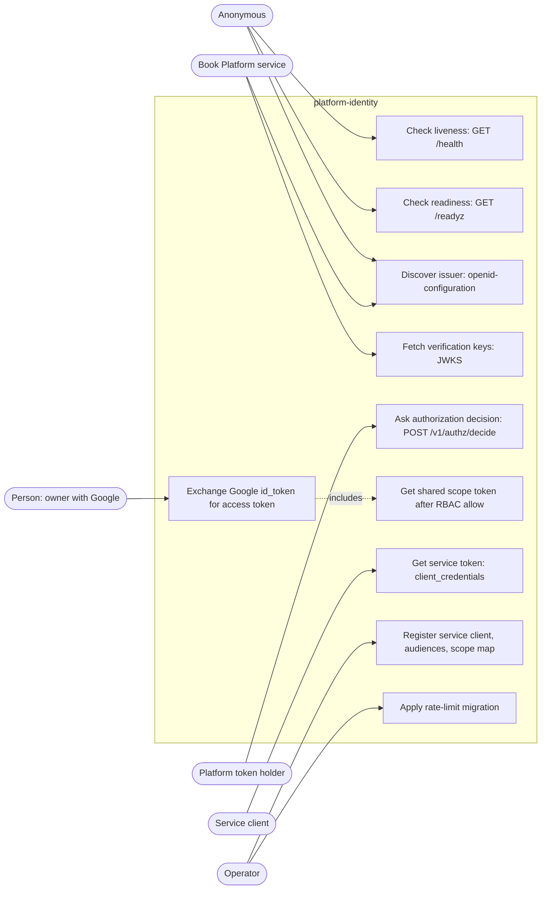

# 02 — Use cases

Actors คือระดับการยืนยันตัวที่โค้ดตรวจจริง (ไม่ใช่หน้า UI เพราะไม่มี UI)

| Actor | ยืนยันตัวด้วยอะไร | ตรวจที่ไหน |
|---|---|---|
| Anonymous caller | ไม่มี | `/health`, `/readyz`, `/.well-known/*` |
| Platform token holder (platform-empire / tasks-api shadow mirror) | Bearer RS256 JWT, issuer `IDENTITY_PLATFORM_ISSUER`, audience `platform-api`, ช่อง `x-empire-channel` ∈ api, mcp, workflow, cli, event | `auth.TokenVerifier.verify` |
| Person (owner) | Google id_token ของ client id ใน `IDENTITY_GOOGLE_CLIENT_IDS` + active membership | `google.GoogleVerifier`, SQL ใน `/v1/token` |
| Service client (`posture-monitor`, `mcp-hub`; planned `ai-gateway`, workflow workers) | `private_key_jwt` assertion ตามทะเบียน `IDENTITY_SERVICE_CLIENTS_JSON` | `service_clients.verify_assertion` |
| Book Platform service (token consumer) | ดึง JWKS สาธารณะ | `/.well-known/jwks.json` |
| Operator (owner) | Railway CLI / admin DSN | env config, `identity-rate-limit-migrate` |

Sources: `src/platform_identity/app.py`, `src/platform_identity/auth.py`, `src/platform_identity/google.py`, `src/platform_identity/service_clients.py`, `src/platform_identity/config.py`, `src/platform_identity/rate_limit.py`, `docs/SERVICE-CLIENTS.md`, `docs/PLATFORM-SERVICES-CUTOVER.md`, ops record: book-platforms-status (2026-11-03) (`mcp-hub` client)

## Scope rules ที่ใช้แยกสิทธิ์

- `/v1/authz/decide`: ถ้า token มี `scope` แล้ว `action` ไม่อยู่ใน scope → 403 `scope_insufficient` (scope แคบลงได้ ไม่กว้างขึ้น)
- `/v1/token` person: scope ต้องเป็น canonical permission `<domain>.<resource>:<action>` หรือ shared scope ใน `IDENTITY_SHARED_SCOPE_PERMISSIONS_JSON` (35 scopes ณ 2026-11-03); shared scope ต้องผ่าน `platform.authorize` = allow
- `/v1/token` service client: scope ⊆ ที่ลงทะเบียน; ไม่เรียก `platform.authorize` ("The registration is the authorization")

## Open questions

- ค่าปัจจุบันของ `IDENTITY_TOKEN_AUDIENCES`: cutover doc ระบุ 9 audiences (รวม `security-api`), ops record ระบุว่าเพิ่ม `payment-api` ภายหลัง; ไม่มีไฟล์ใน repo ยืนยันรายการล่าสุด
- `mcp-hub` client (31 scopes, 8 audiences) ไม่ได้บันทึกใน docs ของ repo นี้ มีแค่ใน ops record
