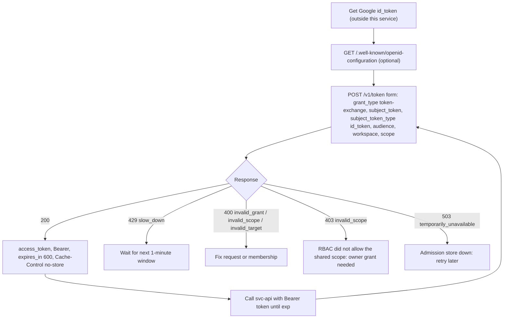
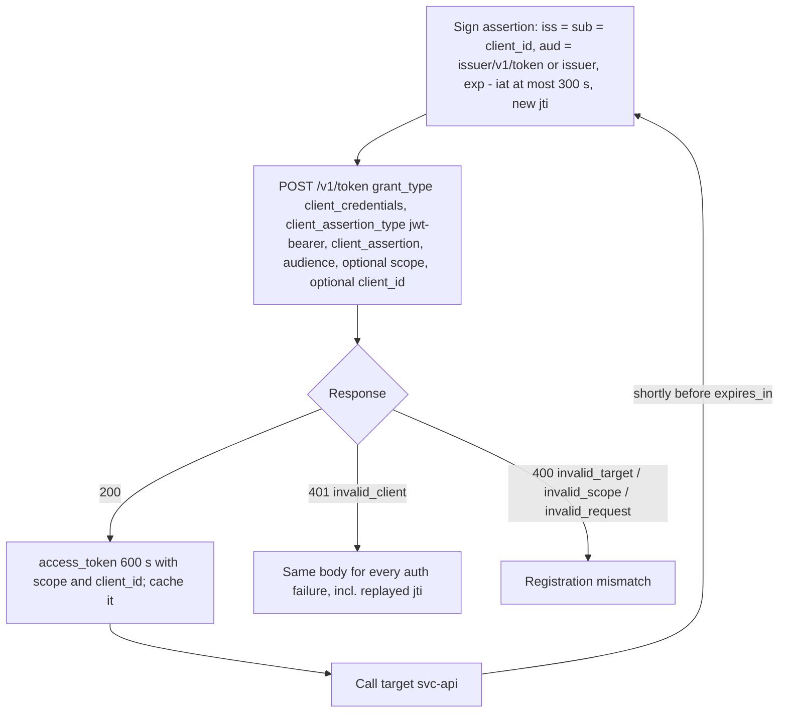
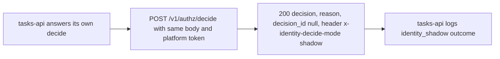
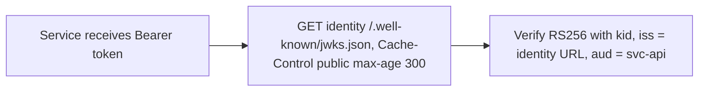

# 03 — User flows (API call flows per caller)

ไม่มีหน้า UI; "user flow" ในที่นี้คือลำดับการเรียก API ของ caller แต่ละแบบ

## Flow A — Person (owner) ขอ token ไปเรียก service

Sources: `src/platform_identity/app.py` (`token`, `_token_error`), `docs/PLATFORM-SERVICES-CUTOVER.md` step 5

## Flow B — Service client (เช่น posture-monitor, mcp-hub)

Sources: `src/platform_identity/service_clients.py`, `src/platform_identity/app.py` (`service_token`), `docs/SERVICE-CLIENTS.md` (Request, Errors, Operating)

## Flow C — platform-empire shadow mirror

Sources: `README.md` (Service, step 3), `src/platform_identity/app.py` (`decide`), `docs/DESIGN-2026-10-13.md` step 3

## Flow D — Token consumer (Book Platform service)

Sources: `src/platform_identity/app.py` (`jwks`), `docs/CONTRACT-SURFACE.md` (Behaviour notes), `docs/PLATFORM-SERVICES-CUTOVER.md`

## Open questions

- Flow C ยังทำงานอยู่หรือไม่ (`IDENTITY_SHADOW_URL` ยังตั้งบน tasks-api?) ไม่มีหลักฐานหลัง 2026-10-14 ใน repo นี้
- ใครเป็นผู้ได้ Google id_token ให้ owner (web app ใด) ยังไม่ถูกกำหนด
