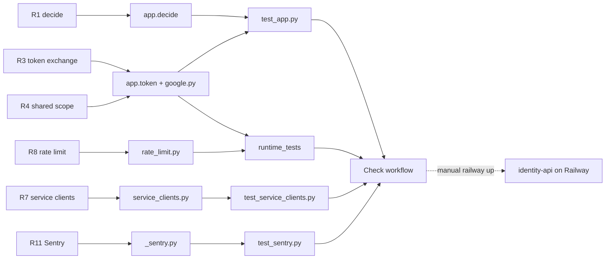

# 04 — Traceability (RTM)

Requirement มาจาก `PRODUCT.md` (What exists), `contract.json` (`interfaces`, `migration_gates`), `docs/SERVICE-CLIENTS.md` และ `docs/SHARED-RATE-LIMIT.md`
release = workflow `Check` (`.github/workflows/check.yml`) + deploy มือด้วย `railway up` (ไม่มี deploy workflow)

| ID | Requirement (source) | Code module | Test file / test | Release / workflow |
|---|---|---|---|---|
| R1 | Authorization decision, same body and `platform.authorize` as platform; shadow rolls back (`PRODUCT.md`, `identity.http.authz-decide`) | `app.py` `decide`, `bound` | `tests/service/test_app.py` `test_shadow_decide_answers_like_the_platform_and_records_nothing`, `test_record_mode_commits_and_returns_the_decision_id`, `test_delegated_token_passes_delegation_and_on_behalf_of`, `test_decide_fails_closed_when_authorize_returns_no_row` | `Check` / service job; deploy 2026-10-14 onward |
| R2 | Accept and refuse the same platform tokens as platform-empire (`auth.py` docstring) | `auth.py` `TokenVerifier` | `test_app.py` `test_refuses_what_the_platform_refuses`, `test_rejects_tokens_for_another_audience_or_issuer`, `test_kidless_platform_tokens_verify_against_any_published_key` | `Check` / service |
| R3 | Token exchange Google id_token → token bound to one audience + one workspace (`PRODUCT.md`, D3) | `app.py` `token`, `google.py` | `test_app.py` `test_exchanges_a_google_id_token_for_a_workspace_member`, `test_token_exchange_refusals`, `test_token_validation_errors_do_not_echo_the_subject_token` | `Check` / service |
| R4 | Shared scope minted only after `platform.authorize` allow (`SHARED-RATE-LIMIT.md` "Explicit shared scope bridge") | `app.py` `token`, `config.validate_shared_scope_permissions` | `runtime_tests/test_rate_limit.py` `test_shared_scope_requires_rbac_and_core_accepts_issued_token`, `test_shared_scope_denied_without_token_on_rbac_refusal`, `test_shared_scope_unknown_or_wrong_workspace_cannot_mint`, length-boundary tests | `Check` / admission job (PostgreSQL) |
| R5 | Key discovery JWKS + openid-configuration, only public key (`identity.http.jwks`) | `app.py` `jwks`, `openid_configuration`; `keys.py` `SigningKey`, `rsa_jwk` | `test_app.py` `test_jwks_publishes_only_the_public_signing_key`; `test_service_clients.py` `test_discovery_advertises_the_grant` | `Check` / service |
| R6 | Remote JWKS outage keeps last good keys (`keys.py` docstring) | `keys.py` `RemoteJwks` | `test_app.py` `test_jwks_outage_keeps_the_last_good_keys` | `Check` / service |
| R7 | Service clients: `client_credentials` + `private_key_jwt`, single-use jti, bounded by registration (`SERVICE-CLIENTS.md`) | `service_clients.py`, `app.py` `service_token`, `config.py` | `tests/service/test_service_clients.py` (all 20 tests incl. `ReplayCacheTest`, `ServiceClientConfigTest`) | `Check` / service; deployed 2026-11-03 (`a9bbfae`) |
| R8 | Token endpoint rate limited; local per instance or shared PostgreSQL, fail closed (`SHARED-RATE-LIMIT.md`) | `app.py` `RateLimiter`, `client_address`; `rate_limit.py` | `test_app.py` `test_token_endpoint_is_rate_limited_by_the_last_proxy_hop`; `test_service_clients.py` `test_client_credentials_requests_are_rate_limited`; `runtime_tests/test_rate_limit.py` (two-process, spoofing, outage, grants, migration CLI) | `Check` / service + admission |
| R9 | Readiness checks DB and limiter, generic 503 (`SHARED-RATE-LIMIT.md`) | `app.py` `readyz`, `rate_limit.bounded_pool` | `runtime_tests/test_rate_limit.py` `test_api_dependency_failure_is_safe_503_and_not_ready`, `test_bounded_primary_pool_readiness_exhaustion_and_lifespan`, `test_privileged_primary_pool_is_not_ready` | `Check` / admission |
| R10 | Health for Railway health check (`PRODUCT.md`) | `app.py` `health` | none (no direct test of `/health`) | `railway.toml` `healthcheckPath` |
| R11 | Error reporting, scrubbed, errors only (`PRODUCT.md`) | `_sentry.py` | `tests/service/test_sentry.py` (8 tests) | `Check` / service |
| R12 | Contract valid, docs agree, schema pin (`README.md` Local verification) | `scripts/check.py`, `check_schema_pin.py`, `check_registry_alignment.py` | `tests/test_contract_check.py`, `tests/test_drift_checks.py` | `Check` / service `test-command` |
| R13 | Migration gate: tenant isolation (`contract.json`) | RLS via `set_config('app.workspace_id')` in `bound`; role check in `bounded_pool` | `runtime_tests/test_rate_limit.py` `test_shared_scope_unknown_or_wrong_workspace_cannot_mint` (partial) | not evidenced in registry |
| R14 | Migration gate: credential rotation (`contract.json`) | `RemoteJwks` multi-key + `decode_with_any` (verify side only) | `test_kidless_platform_tokens_verify_against_any_published_key` (verify side) | gap: no rotation of identity's own signing key |
| R15 | Migration gate: session parity (`contract.json`) | `decide` shadow | parity test lives in platform-empire `tests/test_identity_shadow.py` (per `README.md`) | gap: no parity report |
| R16 | Planned: workspace admin API (`identity.http.workspace-admin`) | none | none | not built |

Sources: `PRODUCT.md`, `contract.json`, `docs/SERVICE-CLIENTS.md`, `docs/SHARED-RATE-LIMIT.md`, `src/platform_identity/*.py`, `tests/service/*.py`, `tests/test_*.py`, `runtime_tests/test_rate_limit.py`, `.github/workflows/check.yml`, `railway.toml`, `docs/PLATFORM-SERVICES-CUTOVER.md`

Sources: same as table

## Open questions

- R13–R15: หลักฐาน migration gate ต้องบันทึกใน "parent platform registry" (`README.md` Migration gate) ยังไม่พบใน repo นี้
- `/health` ไม่มี test ตรง ๆ
