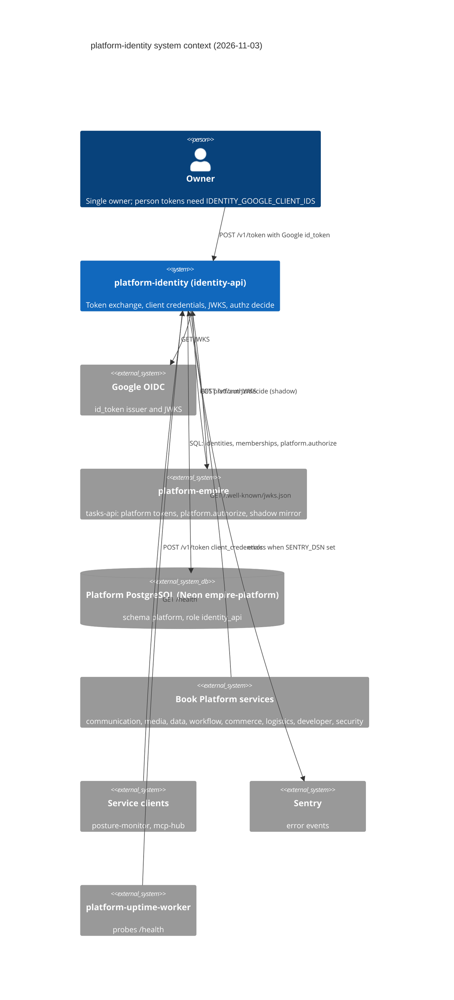

# 05 — C4 Context

Sources: `src/platform_identity/app.py`, `src/platform_identity/google.py` (`GOOGLE_JWKS_URL`), `src/platform_identity/config.py` (`IDENTITY_PLATFORM_JWKS_URL`), `src/platform_identity/_sentry.py`, `README.md`, `PRODUCT.md` (uptime probe), `docs/DESIGN-2026-10-13.md` step 3 (role `identity_api`, platform-empire DB), `docs/PLATFORM-SERVICES-CUTOVER.md`, ops record: book-platforms-status (2026-11-03)

หมายเหตุ: `payment-api` มี audience ใน identity ตาม ops record แต่ readyz ยัง 503 จึงไม่ได้วาดเป็นผู้ใช้ JWKS ที่ยืนยันแล้ว

## Open questions

- Neon project ที่ `IDENTITY_DATABASE_URL` ชี้: design บอกว่าเป็น DB ของ platform-empire (schema `platform`); ชื่อ Neon project `empire-platform` มาจาก cutover doc ("Neon `empire-platform` quota") ยืนยันจาก Railway variables ไม่ได้ใน repo
- `IDENTITY_PLATFORM_JWKS_URL` หรือ PEM: ใช้แบบไหนใน production ไม่ระบุใน repo
