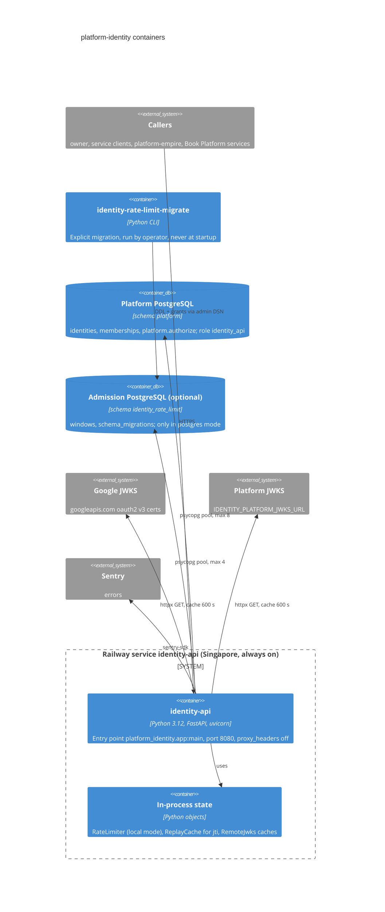

# 06 — C4 Container

Sources: `Dockerfile`, `railway.toml`, `pyproject.toml` (`[project.scripts]`), `src/platform_identity/app.py` (`main`, `create_app`, `RateLimiter`), `src/platform_identity/service_clients.py` (`ReplayCache`), `src/platform_identity/keys.py` (`RemoteJwks`, `JWKS_CACHE_SECONDS`), `src/platform_identity/rate_limit.py`, `src/platform_identity/config.py`, `src/platform_identity/migrations/0001_token_rate_limit.sql`, `docs/SHARED-RATE-LIMIT.md`

## Open questions

- `IDENTITY_RATE_LIMIT_MODE` ใน production เป็น `local` (default) หรือ `postgres`; ถ้า postgres, `IDENTITY_RATE_LIMIT_DATABASE_URL` ชี้ DB ไหน ไม่มีบันทึก
