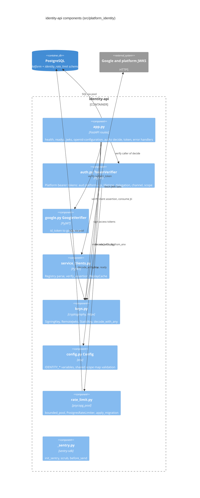

# 07 — C4 Component (identity-api)

Sources: `src/platform_identity/app.py`, `auth.py`, `google.py`, `service_clients.py`, `keys.py`, `config.py`, `rate_limit.py`, `_sentry.py`, `__init__.py`

หมายเหตุ: `_sentry.init_sentry` ถูกเรียกจาก package `__init__` (ตาม docstring ของ `_sentry.py`)

## Open questions

- ไม่มี
