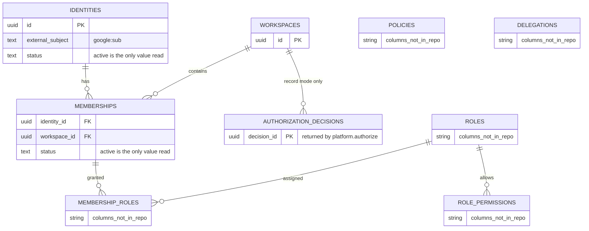
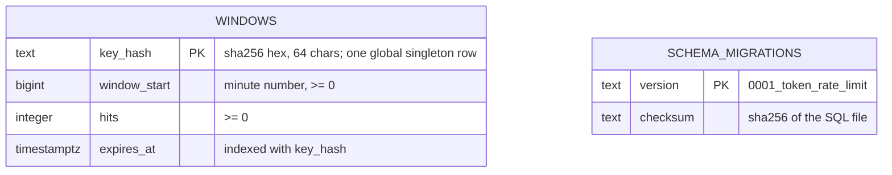

# 09 — ERD

ข้อมูลที่ service นี้อ่าน/เขียนมีสองกลุ่ม

1. **schema `platform` (เป็นของ platform-empire)** — repo นี้ไม่มี migration ของตารางเหล่านี้; คอลัมน์ด้านล่างมีเฉพาะที่ SQL ใน `app.py` ใช้จริง ตารางอื่นในกลุ่มมีชื่อใน `contract.json` แต่ไม่รู้คอลัมน์
2. **schema `identity_rate_limit` (เป็นของ repo นี้)** — จาก `migrations/0001_token_rate_limit.sql` และ `rate_limit.py`

Sources: `src/platform_identity/app.py` (SQL in `decide` and `token`), `contract.json` (`identity.table.workspace-rbac`), `docs/DESIGN-2026-10-13.md` §1 ตาราง "อยู่ที่ไหนตอนนี้", §4

ความสัมพันธ์ `MEMBERSHIP_ROLES`/`ROLE_PERMISSIONS` วาดจากชื่อตารางเท่านั้น (ชื่อบอกความหมาย) cardinality จริงไม่อยู่ใน repo

Sources: `src/platform_identity/migrations/0001_token_rate_limit.sql`, `src/platform_identity/rate_limit.py` (`apply_migration`, `PostgresRateLimiter`)

## RLS และ runtime role

| Schema | Runtime role | Rule | Source |
|---|---|---|---|
| `platform` | `identity_api` | forced RLS บน `app.workspace_id`; service ตั้งค่าใน transaction ทุกครั้ง (`set_config('app.workspace_id', ws, true)`) แล้ว rollback; reset เป็น `''` เมื่อคืน connection | `contract.json`, `app.py` `bound`, `rate_limit.py` `bounded_pool.reset`, design ขั้น 3 |
| ทุก pool | serving role | ต้อง `NOSUPERUSER NOBYPASSRLS` ไม่งั้น connection ถูกปฏิเสธ; ตั้ง `statement_timeout`, `lock_timeout`, `idle_in_transaction_session_timeout` | `rate_limit.py` `bounded_pool.configure` |
| `identity_rate_limit` | เช่น `identity_rate_limiter` | `USAGE` schema; `SELECT, INSERT, UPDATE, DELETE` บน `windows`; `SELECT` บน `schema_migrations`; revoke PUBLIC; migration รันด้วย admin DSN แยกเท่านั้น | `rate_limit.py` `apply_migration`, `docs/SHARED-RATE-LIMIT.md` |

ไม่มีข้อมูลที่ service นี้เก็บถาวรเองนอกจาก admission counters (และ `authorization_decisions` เมื่อ `IDENTITY_DECIDE_MODE=record`); ไม่เก็บ password, id_token หรือ access token

## Open questions

- คอลัมน์และ FK จริงของตาราง `platform.*` อยู่ใน platform-empire `services/platform/migrations/0001_platform_core.sql` และ `0003_authorization_decision_point.sql` (ชื่อจาก `contract.json`) ซึ่งไม่ได้อ่านในงานนี้
- ค่า `status` อื่นนอกจาก `active` ของ identities/memberships
