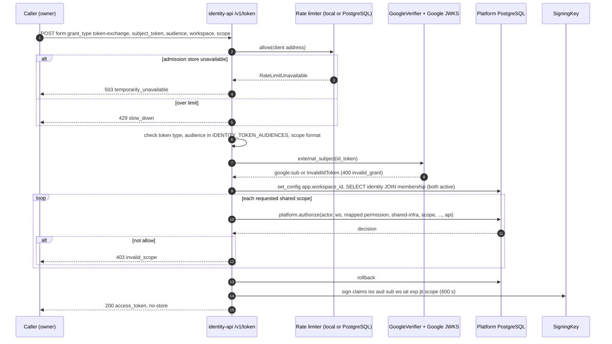
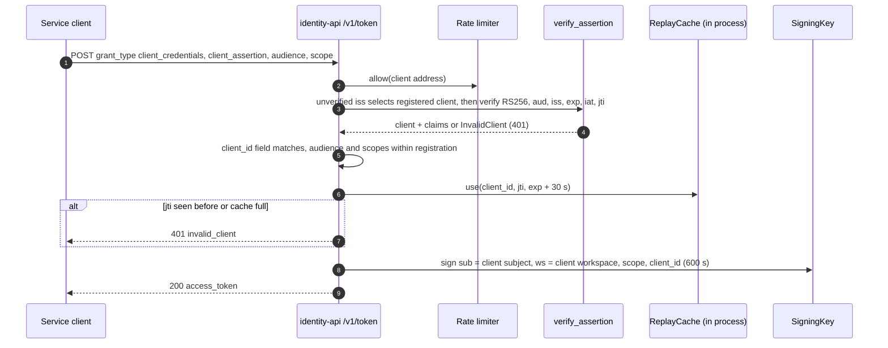
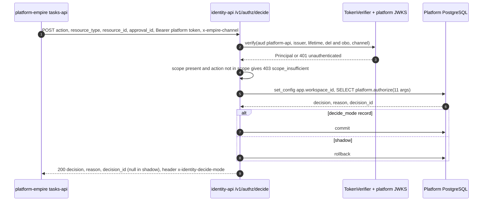
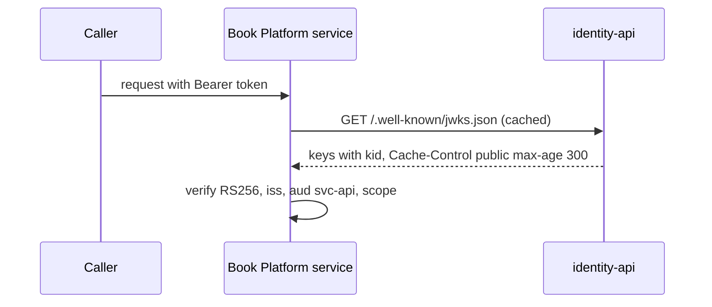

# 10 — Sequences

## 1. Token exchange (person, shared scope)

Sources: `src/platform_identity/app.py` (`token`, `bound`), `src/platform_identity/google.py`, `src/platform_identity/rate_limit.py`, `docs/SHARED-RATE-LIMIT.md`

## 2. Client credentials (service client)

Sources: `src/platform_identity/service_clients.py`, `src/platform_identity/app.py` (`service_token`), `docs/SERVICE-CLIENTS.md`

## 3. Shadow authorization decision

Sources: `src/platform_identity/app.py` (`decide`, `caller`, `bound`), `src/platform_identity/auth.py`, `README.md` (step 3)

## 4. Token consumer verifies (JWKS)

Sources: `src/platform_identity/app.py` (`jwks`), `docs/PLATFORM-SERVICES-CUTOVER.md`, `docs/CONTRACT-SURFACE.md`

## Open questions

- ฝั่ง consumer (platform-backend-core) cache JWKS นานเท่าไร: `CONTRACT-SURFACE.md` พูดถึง cellkit (10 นาที) ไม่ใช่ platform-backend-core
