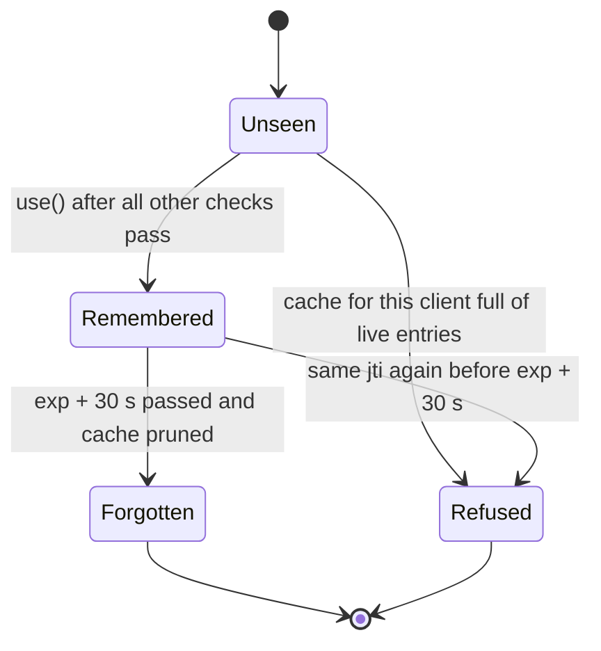
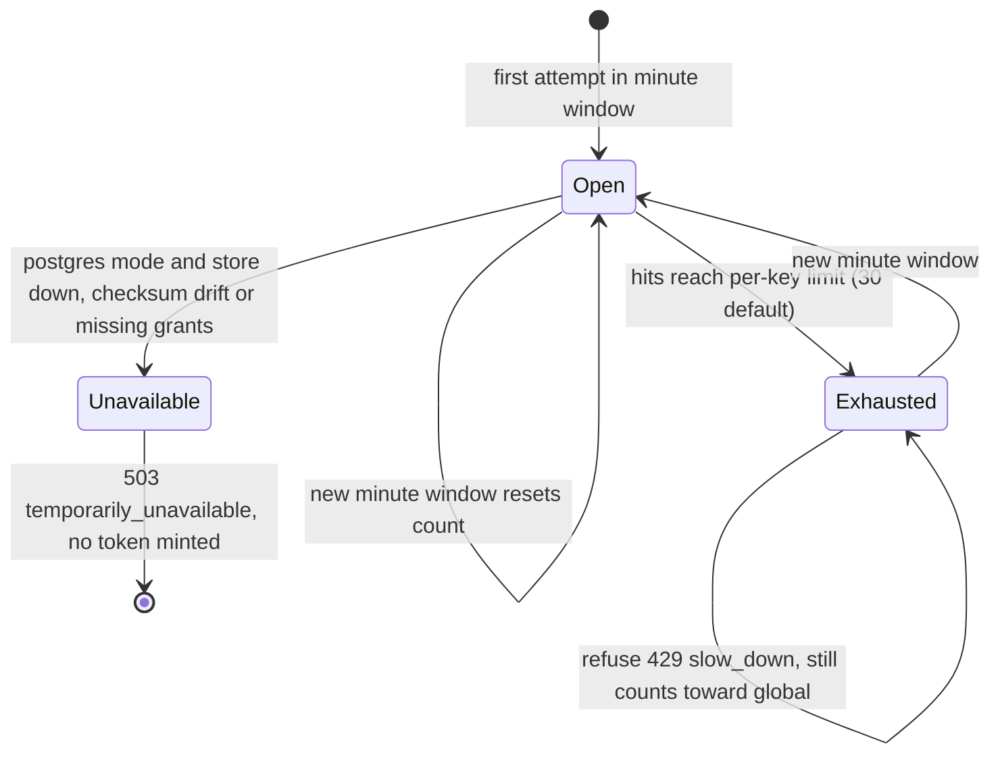
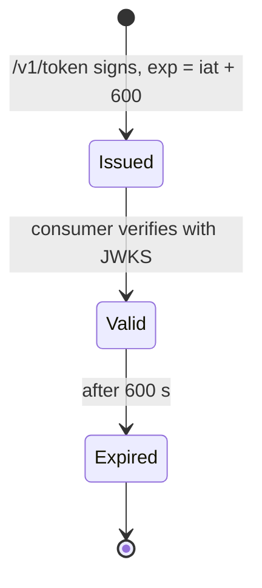
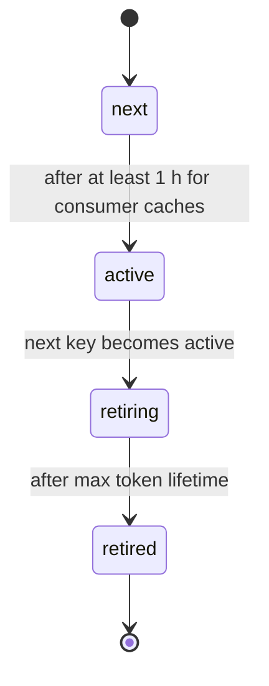

# 11 — State machines

## 1. Client assertion `jti` (ReplayCache, ต่อ process)

Sources: `src/platform_identity/service_clients.py` (`ReplayCache.use`, `max_entries_per_client = 1_000`), `src/platform_identity/app.py` ("Consume the jti last, so a request refused above does not burn a valid assertion"), `tests/service/test_service_clients.py` (`ReplayCacheTest`)

## 2. Rate-limit window per key (หนึ่งนาที)

Sources: `src/platform_identity/app.py` (`RateLimiter`, `TOKEN_REQUESTS_PER_MINUTE = 30`), `src/platform_identity/rate_limit.py` (`PostgresRateLimiter.allow`), `docs/SHARED-RATE-LIMIT.md` (Admission correctness)

## 3. Access token (ออกโดย service นี้)

ไม่มี state "revoked": ไม่มี revocation list ในโค้ด (`docs/SERVICE-CLIENTS.md` Limits: "Tokens already issued live at most 600 s")

Sources: `src/platform_identity/app.py` (`ACCESS_TOKEN_TTL_SECONDS`)

## 4. Identity / membership status

โค้ดอ่านเฉพาะ `status = 'active'` ของ `platform.identities` และ `platform.memberships`; สถานะอื่นและการเปลี่ยนสถานะเป็นของ platform-empire จึงวาด lifecycle ไม่ได้ (ดู Open questions)

## 5. (Planned, ไม่มีโค้ด) signing key rotation

Sources: `docs/DESIGN-2026-10-13.md` §5 (planned table `identity.signing_keys`); โค้ดปัจจุบันมี key เดียว (`app.py` `jwk_set = {"keys": [signing_key.jwk]}`)

## Open questions

- ค่าที่เป็นไปได้ของ `identities.status` / `memberships.status` และใครเปลี่ยน (platform-empire migrations)
- แผนหมุน signing key ของ identity เอง (ข้อ 5) จะทำเมื่อไร
