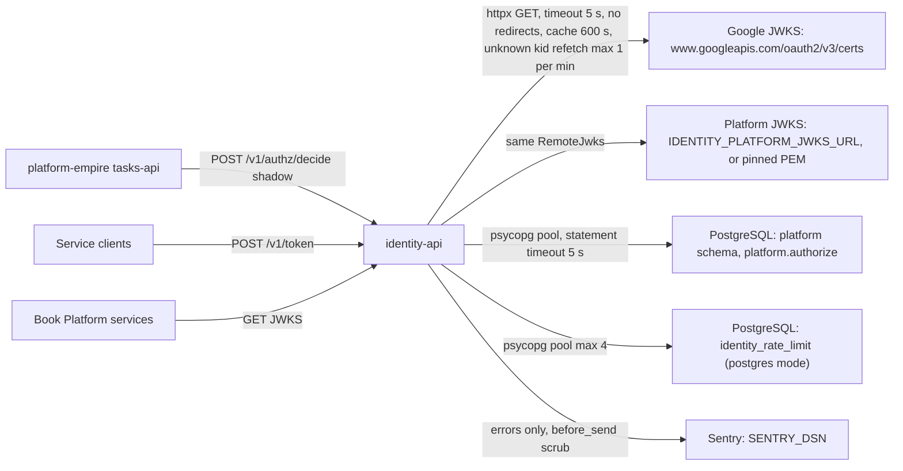

# 12 — API & integrations

ตาราง contract อย่างเป็นทางการ: [`docs/CONTRACT-SURFACE.md`](../CONTRACT-SURFACE.md) (reused, ไม่คัดลอก) — หมายเหตุ: หน้านั้นยังบอกว่า interface เป็น `pilot`/`planned` ที่ platform-empire เสิร์ฟ ส่วนตารางด้านล่างคือสิ่งที่ router ใน repo นี้เสิร์ฟจริง

## Routes (จาก `src/platform_identity/app.py`)

| Method | Path | Auth / scope | Request | Responses | Idempotency |
|---|---|---|---|---|---|
| GET | `/health` | public | — | 200 `{status, service, decide_mode}` | safe |
| GET | `/readyz` | public | — | 200 `ready` / 503 `unavailable` (generic; checks primary pool `SELECT 1` and limiter `ready()`) | safe |
| GET | `/.well-known/jwks.json` | public | — | 200 JWK Set, `Cache-Control: public, max-age=300` | safe |
| GET | `/.well-known/openid-configuration` | public | — | 200 issuer, jwks_uri, token_endpoint, grants (token-exchange, + client_credentials when clients registered), auth methods, RS256 | safe |
| POST | `/v1/authz/decide` | Bearer platform JWT: issuer `IDENTITY_PLATFORM_ISSUER`, aud `platform-api`, RS256, lifetime ≤ 3600 s (delegated ≤ `IDENTITY_PLATFORM_MAX_LIFETIME`); header `x-empire-channel` ∈ api/mcp/workflow/cli/event; if token has `scope`, `action` must be in it | JSON `action` (`<domain>.<resource>:<read\|write\|delete\|approve\|admin>`), `resource_type` ≤ 64, `resource_id` ≤ 200, `approval_id?` | 200 `{decision, reason, decision_id}` + `x-identity-decide-mode`; 401 `unauthenticated`; 403 `scope_insufficient`; 422 validation; 503 `unavailable` | shadow: no write (rollback) so repeat-safe; record: each call commits a new decision (no Idempotency-Key) |
| POST | `/v1/token` (token-exchange) | subject token = Google id_token for a configured client id; active membership; shared scopes need `platform.authorize` allow | form `grant_type`, `subject_token`, `subject_token_type`, `audience`, `workspace`, `scope?` | 200 token (600 s, `no-store`); 400 `invalid_request`/`invalid_target`/`invalid_scope`/`invalid_grant`/`unsupported_grant_type`; 403 `invalid_scope`; 429 `slow_down`; 503 `temporarily_unavailable` | not idempotent: each call mints a new `jti` |
| POST | `/v1/token` (client_credentials) | `private_key_jwt` assertion of a registered client | form `grant_type`, `client_assertion_type`, `client_assertion`, `audience`, `scope?`, `client_id?` | 200 token with `client_id`; 401 `invalid_client`; 400 `invalid_target`/`invalid_scope`/`invalid_request` | assertion `jti` single use; replay = 401 |
| GET | `/openapi.json` | public | — | FastAPI schema (`docs_url` and `redoc_url` are off, `openapi_url` is left at the default) | safe |

Sources: `src/platform_identity/app.py`, `src/platform_identity/auth.py` (`CHANNELS`, `MAX_LIFETIME_SECONDS`), `src/platform_identity/service_clients.py`, `docs/SERVICE-CLIENTS.md` (Errors)

Error shape: `/v1/token` ตอบ OAuth shape `{error, error_description}` และไม่ echo subject token (validation error → 400 `invalid_request`); route อื่นตอบ `{"detail": ...}` (`http_error`, `invalid_request` handlers)

## External integrations

Sources: `src/platform_identity/keys.py` (`RemoteJwks`), `src/platform_identity/google.py` (`GOOGLE_JWKS_URL`), `src/platform_identity/config.py`, `src/platform_identity/rate_limit.py`, `src/platform_identity/_sentry.py`, `README.md`, `docs/PLATFORM-SERVICES-CUTOVER.md`

ไม่มี webhook, ไม่มี provider อื่น (Stripe, Resend, R2) ในโค้ด

## Open questions

- ควรปิด `/openapi.json` (`openapi_url=None`) ให้ตรงกับเจตนาที่ปิด `/docs` หรือไม่
- `/v1/token` person path ใช้ไม่ได้จนกว่า owner ตั้ง `IDENTITY_GOOGLE_CLIENT_IDS`
