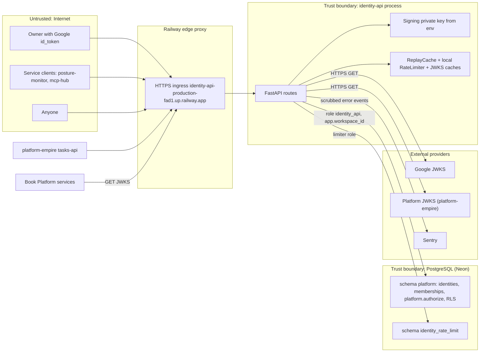

# 13 — Threat model (DFD + STRIDE)

Sources: `src/platform_identity/*.py`, `railway.toml`, `docs/PLATFORM-SERVICES-CUTOVER.md` (issuer URL), `docs/DESIGN-2026-10-13.md` §9, `docs/SHARED-RATE-LIMIT.md`

## STRIDE per element

| Element | Threat | Existing mitigation (code) | Gap |
|---|---|---|---|
| `/v1/token` token-exchange | **S**poofing: forged or foreign id_token | RS256 against Google JWKS, audience = own client ids, issuer allowlist, numeric `sub` ≤ 64, leeway 30 s (`google.py`); test `test_token_exchange_refusals` | — |
| `/v1/token` token-exchange | **I**nfo disclosure: membership enumeration | same `invalid_grant` for unknown person and non-member (`app.py`) | — |
| `/v1/token` token-exchange | **E**levation: request a scope not granted | canonical/shared scope regex; shared scope needs `platform.authorize` allow; ≤ 32 scopes; map validated at startup (`config.validate_shared_scope_permissions`) | canonical scopes (non-shared) are copied into the token without an RBAC check (legacy behaviour kept by `SHARED-RATE-LIMIT.md`); consumers must still authorize |
| `/v1/token` client_credentials | **S**poofing / replay of assertion | RS256 per-client public key, `aud` single string, `exp - iat` ≤ 300 s, `jti` single-use, `iss = sub = client_id` (`service_clients.py`) | replay cache is per process; documented limit before > 1 replica (`SERVICE-CLIENTS.md` Limits) |
| `/v1/token` client_credentials | **I**nfo disclosure: client id existence via timing | — | documented and accepted ("client ids are not secret") |
| `/v1/token` both | **D**oS: token flooding | 30/min per key in memory; optional PostgreSQL global + per-key, fail closed 503; `limit_concurrency` 64, keep-alive 5 s (`app.main`) | local mode keys on last `X-Forwarded-For` hop; correctness depends on Railway proxy appending the peer (not verified in repo) |
| `/v1/authz/decide` | **S**poofing: forged platform token | RS256, issuer, aud `platform-api`, required claims, lifetime cap, `del`/`obo` pairing, channel allowlist (`auth.py`); tests `test_refuses_what_the_platform_refuses` | — |
| `/v1/authz/decide` | **E**levation: cross-workspace | workspace comes from the verified token, set as `app.workspace_id`; forced RLS (contract); role not BYPASSRLS (`bounded_pool`) | RLS policies themselves live in platform-empire (not reviewable here) |
| `/v1/authz/decide` | **R**epudiation | record mode commits `authorization_decisions`; shadow records nothing by design | in shadow no audit of identity's own answers |
| Signing key | **T**ampering / **I**nfo disclosure | private PEM only from env, `repr=False`, ≥ 2048 bit; JWKS exposes public half only (test `test_jwks_publishes_only_the_public_signing_key`) | single key, no rotation states; no KMS (design §9 "ระยะยาวควรย้ายไป KMS") |
| Access tokens | **R**epudiation / misuse after leak | 600 s TTL, `jti`, `Cache-Control: no-store`, subject token never echoed | no revocation |
| PostgreSQL | **T**ampering | parameterized SQL; statement/lock/idle timeouts; migrations never at startup; checksum drift fails (`rate_limit.py`) | — |
| Remote JWKS (Google, platform) | **D**oS / **S**poofing of keys | HTTPS only (`require_https`), no redirects, timeout 5 s, last good keys kept on outage | — |
| Sentry egress | **I**nfo disclosure | no locals, no request body/URL/headers, tracing off, log records not sent, `before_send` regex scrub of passwords, bearer tokens, JWTs (`_sentry.py`) | still sends scrubbed exception values and messages; the 8 platform services moved to "no free text" on 2026-11-03 (ops record) and identity has not |
| `/openapi.json` | **I**nfo disclosure | — | schema left public by FastAPI default |
| Ingress | **S**poofing | — | whether identity-api sits behind the edge gateway (`gateway.bookchaowalit.com`) is not stated for this service; issuer is the raw Railway URL |

Sources: `src/platform_identity/app.py`, `auth.py`, `google.py`, `service_clients.py`, `keys.py`, `config.py`, `rate_limit.py`, `_sentry.py`; tests in `tests/service/`; `docs/SERVICE-CLIENTS.md`; `docs/SHARED-RATE-LIMIT.md`; `docs/DESIGN-2026-10-13.md` §9; ops record: book-platforms-status (2026-11-03)

## Open questions

- Port "no free text" Sentry module (security `0187719`) มาที่ identity หรือไม่
- `IDENTITY_TRUSTED_PROXIES` และ rate-limit mode ใน production
- มี gateway route สำหรับ identity หรือไม่
