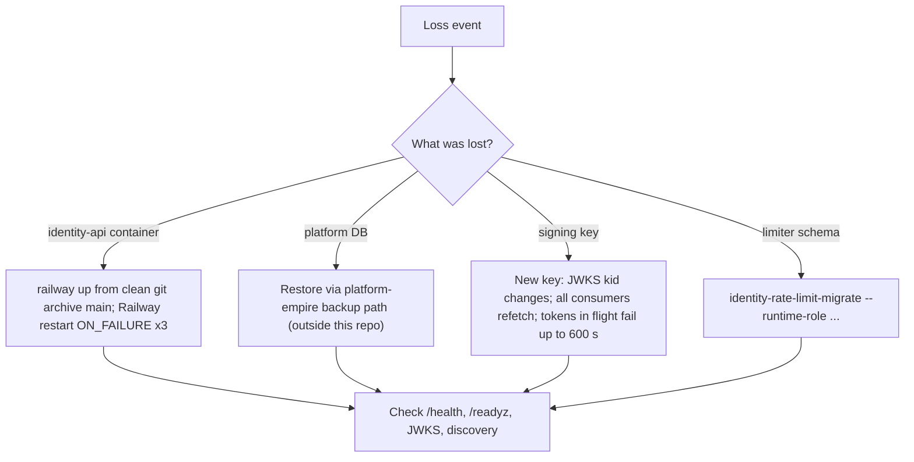

# 14 — Backup & DR

## ข้อมูลที่มีและอยู่ที่ไหน

| Data | Where | Owner | Backup reality |
|---|---|---|---|
| identities, workspaces, memberships, roles, policies, delegations, `authorization_decisions` | PostgreSQL schema `platform` (DB ของ platform-empire) | platform-empire | ไม่มีอะไรใน repo นี้; ADR-0002 กลางบอกว่าฐานข้อมูล Neon ทุกตัว dump ทุกคืน 02:00 BKK ด้วย `ops-backups/db-backup` แต่รายการ target ไม่อยู่ใน repo นี้ |
| `identity_rate_limit.windows`, `schema_migrations` | PostgreSQL (postgres mode เท่านั้น) | this repo | counters อายุ ≤ 2 นาที ไม่ต้อง backup; `schema_migrations` สร้างใหม่ได้ด้วย CLI (idempotent) |
| Signing private key | Railway variable `IDENTITY_SIGNING_KEY_PEM` | operator | ไม่มีบันทึกว่ามีสำเนาที่อื่น (Infisical path ไม่ระบุใน repo) |
| Service client registry, audiences, shared scope map | Railway variables | operator | map สร้างใหม่ได้จาก platform-empire `PLATFORM_SHARED_SCOPES` (cutover doc); registry = public keys เท่านั้น |
| Replay cache, local limiter, JWKS caches | process memory | — | หายเมื่อ restart โดยออกแบบ |
| Code | GitHub `bookchaowalit-backend/platform-identity` | — | git |

Sources: `docs/SHARED-RATE-LIMIT.md`, `src/platform_identity/rate_limit.py`, `railway.toml`, `docs/PLATFORM-SERVICES-CUTOVER.md` (deploy + checks), `docs/DESIGN-2026-10-13.md` (DB ของ platform-empire), central ADR-0002: [ADR-0002-production-baseline-monitoring-backups.md](https://github.com/bookchaowalit/architecture-docs/blob/main/docs/architecture/decisions/ADR-0002-production-baseline-monitoring-backups.md)

## RTO / RPO

- RTO: not defined
- RPO: not defined (สำหรับ schema `platform` ขึ้นกับ backup ของ platform-empire)

## Open questions

- Neon `empire-platform` เป็น target ของ nightly backup และ restore drill หรือไม่
- มีสำเนา `IDENTITY_SIGNING_KEY_PEM` ใน Infisical หรือไม่; ถ้าไม่มี การหาย key = ทุก service ต้องรอ JWKS ใหม่
- design ขั้น 3 ระบุ rollback = "ปิด service" และลบ `IDENTITY_SHADOW_URL`; หลัง 2026-10-29 มี 8 services เชื่อ issuer นี้ rollback plan ใหม่คืออะไร
