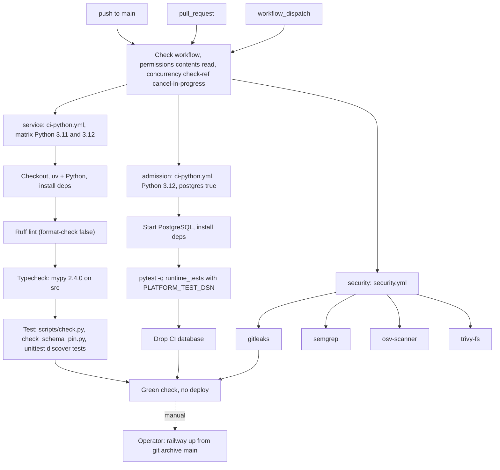

# 15 — CI/CD pipeline

workflow เดียว: `.github/workflows/check.yml` (name `Check`) เรียก reusable workflows ของ `bookchaowalit/platform-ci-workflows` pin ที่ `87dc5e1c` (v1.1.1); public repo จึงใช้ GitHub-hosted runner (default `ubuntu-24.04`)

Sources: `.github/workflows/check.yml`; `platform-ci-workflows` @ `87dc5e1c`: `.github/workflows/ci-python.yml` (steps Checkout, Set up uv and Python, Install dependencies, Start PostgreSQL, Lint (Ruff), Typecheck, Test, Coverage gate, Drop CI database), `.github/workflows/security.yml` (jobs gitleaks, semgrep, osv-scanner, trivy-fs)

หมายเหตุ:
- `coverage-threshold` ไม่ได้ตั้งใน `check.yml` (default `""` = gate ปิด)
- `admission` ปิด lint/typecheck (`lint-command: ""`, `typecheck-command: ""`)
- ไม่มี job ใด deploy (comment ใน `check.yml`: "CI never deploys")

## Open questions

- ไม่มี branch protection / required checks ให้ดูใน repo
