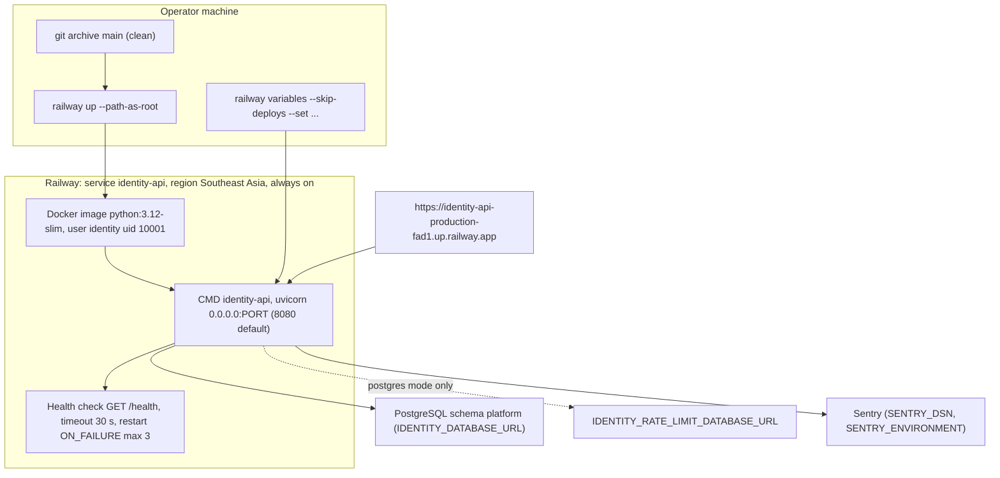

# 16 — Deployment

Sources: `Dockerfile`, `railway.toml`, `pyproject.toml`, `src/platform_identity/config.py` (`HOST`, `PORT`), `src/platform_identity/app.py` (`main`), `README.md` (Sentry variables), `docs/PLATFORM-SERVICES-CUTOVER.md` (issuer URL, `railway up --path-as-root`, `--skip-deploys`), `PRODUCT.md` (Host)

## Environment (names only)

`IDENTITY_DATABASE_URL`, `IDENTITY_SIGNING_KEY_PEM`, `IDENTITY_ISSUER`, `IDENTITY_PLATFORM_ISSUER`, `IDENTITY_PLATFORM_JWKS_URL` / `IDENTITY_PLATFORM_PUBLIC_KEY_PEM`, `IDENTITY_PLATFORM_MAX_LIFETIME`, `IDENTITY_GOOGLE_CLIENT_IDS` (unset 2026-11-03), `IDENTITY_TOKEN_AUDIENCES`, `IDENTITY_SHARED_SCOPE_PERMISSIONS_JSON` (35 scopes), `IDENTITY_SERVICE_CLIENTS_JSON`, `IDENTITY_DECIDE_MODE`, `IDENTITY_RATE_LIMIT_*`, `IDENTITY_TRUSTED_PROXIES`, `IDENTITY_DB_*`, `IDENTITY_MAX_CONCURRENCY`, `SENTRY_DSN`, `SENTRY_ENVIRONMENT`

Sources: `src/platform_identity/config.py`, `docs/PLATFORM-SERVICES-CUTOVER.md`, `README.md`

## Probes

| Path | Meaning | Used by |
|---|---|---|
| `/health` | liveness, always 200 with `decide_mode` | Railway health check, platform-uptime-worker (`PRODUCT.md`) |
| `/readyz` | DB `SELECT 1` + limiter readiness; generic 503 | manual checks after deploy (cutover doc) |

ไม่มี `/healthz` ใน repo นี้; ไม่เปิด Railway sleep (`railway.toml` comment "always on") ต่างจาก 8 platform services ที่เป็น serverless (ops record)

## Known deployments

| Date | Commit | Evidence |
|---|---|---|
| 2026-10-14 | step 3 (`264c136` … `e2b9b50`) | `docs/DESIGN-2026-10-13.md` ขั้น 3 |
| 2026-10-18 | Sentry build | `docs/PLATFORM-SERVICES-CUTOVER.md` ("The live deployment is still the 2026-10-18 build") |
| 2026-11-03 | `a9bbfae`, deployment `7a4e4280` | cutover doc "Deployed 2026-11-03" |
| 2026-11-03 | `6ad4bb9` | cutover doc "Activated 2026-11-03" |

## Open questions

- Railway project name / id, Infisical path ของ identity-api และ Sentry project name ไม่อยู่ใน repo และไม่อยู่ใน ops record บรรทัดที่ระบุ service นี้
- ทำไม identity เป็น always on ขณะที่ services อื่น sleep (ไม่มีเอกสารเหตุผล)
