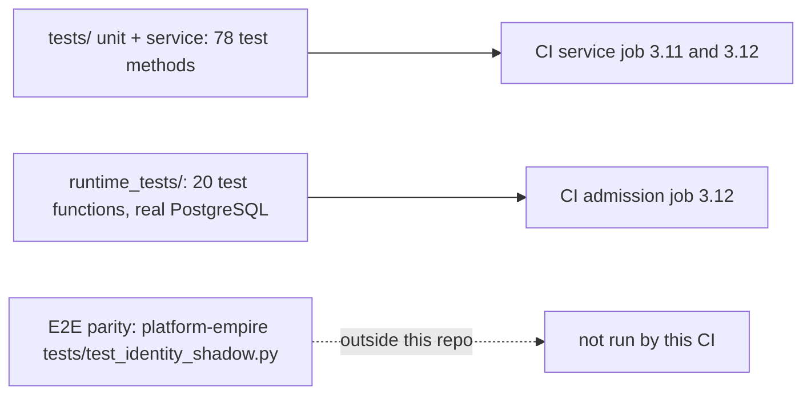

# 17 — Test coverage matrix

ระดับ test ใน repo นี้:
- **unit / service**: `tests/` (unittest, FastAPI `TestClient` + `FakeDatabase`, ไม่มี network) — CI job `service` (3.11, 3.12)
- **integration**: `runtime_tests/test_rate_limit.py` (pytest, PostgreSQL จริงแบบ disposable, NOSUPERUSER/NOBYPASSRLS roles, หลาย process) — CI job `admission` (3.12)
- **e2e**: ไม่มีใน repo; parity test กับ decision point จริงอยู่ที่ platform-empire `tests/test_identity_shadow.py` (`README.md`)

| Feature | Unit / service (`tests/`) | Integration (`runtime_tests/`) | E2E | Gap |
|---|---|---|---|---|
| decide: shadow vs record, delegation, fail closed | `test_app.py` 4 tests | — | external (platform-empire) | no test against real `platform.authorize` here |
| Platform token verification (aud, iss, lifetime, channel, scope, kid-less) | `test_app.py` `test_refuses_what_the_platform_refuses`, `test_rejects_tokens_for_another_audience_or_issuer`, `test_kidless_platform_tokens_verify_against_any_published_key` | — | — | — |
| Token exchange (Google) | `test_app.py` `test_exchanges_a_google_id_token_for_a_workspace_member`, `test_token_exchange_refusals`, `test_token_validation_errors_do_not_echo_the_subject_token` | — | — | no real Google traffic (by design) |
| Shared scope bridge | — | `test_shared_scope_*` (6 tests incl. 128/129 length boundaries) | — | — |
| Service clients / ReplayCache / registry parsing | `test_service_clients.py` 20 tests | — | — | multi-replica replay not tested (documented limit) |
| Rate limit local | `test_app.py` `test_token_endpoint_is_rate_limited_by_the_last_proxy_hop`; `test_service_clients.py` `test_client_credentials_requests_are_rate_limited` | — | — | — |
| Rate limit PostgreSQL (global/per key, spoofing, outage, grants, migration CLI, clock rollover) | — | 12 tests in `test_rate_limit.py` (besides the 2 config and 6 shared-scope tests) | — | — |
| Config validation (`Config.from_env`) | `test_service_clients.py` `test_config_reads_the_registry_from_the_environment` | `test_configuration_*` (2) | — | — |
| JWKS / discovery | `test_app.py` `test_jwks_publishes_only_the_public_signing_key`, `test_jwks_outage_keeps_the_last_good_keys`; `test_service_clients.py` `test_discovery_advertises_the_grant` | — | — | — |
| `/readyz` | — | `test_api_dependency_failure_is_safe_503_and_not_ready`, `test_bounded_primary_pool_readiness_exhaustion_and_lifespan`, `test_privileged_primary_pool_is_not_ready` | — | — |
| `/health` | — | — | Railway health check only | **no test** |
| Sentry scrub and init | `test_sentry.py` 8 tests | — | — | no real-client "no exception text" test (the 8 platform services have one, ops record) |
| Contract / drift checks | `test_contract_check.py` 19, `test_drift_checks.py` 17 | — | — | — |
| Workspace admin API | — | — | — | not built |

Sources: `tests/service/test_app.py`, `tests/service/test_service_clients.py`, `tests/service/test_sentry.py`, `tests/test_contract_check.py`, `tests/test_drift_checks.py`, `runtime_tests/test_rate_limit.py`, `.github/workflows/check.yml`, `README.md`, ops record: book-platforms-status (2026-11-03)

Counts: `grep -c "    def test"` per file under `tests/`; `grep -c "^def test" runtime_tests/test_rate_limit.py` = 20 (some parametrized)

Sources: same as table (78 = 14 + 20 + 8 + 19 + 17)

## Open questions

- No coverage gate (`coverage-threshold` unset); current coverage % unknown
