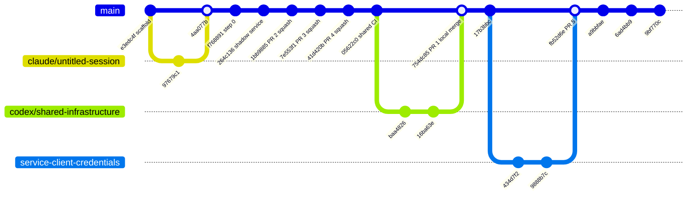
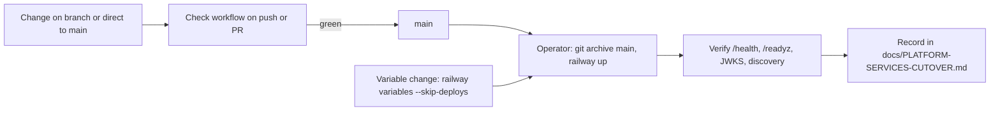

# 18 — Git & release workflow

สิ่งที่เห็นจาก `git log --first-parent origin/main` และ `gh pr list`: ส่วนใหญ่ push ตรงเข้า `main`; PR ใช้ 4 ครั้ง (#2–#5) merge ภายใน 1–3 นาทีหลังเปิด (#2–#4 squash, #5 merge commit); #1 (codex/shared-infrastructure) ถูกปิดแล้ว merge แบบ local เป็น `754dc85`

Sources: `git log --first-parent --format='%h %ad %s' origin/main`, `gh pr list -R bookchaowalit-backend/platform-identity --state all`

Sources: `.github/workflows/check.yml`, `docs/PLATFORM-SERVICES-CUTOVER.md`, `PRODUCT.md`

หมายเหตุ: ไม่มี tag หรือ GitHub release; version ใน `pyproject.toml` คงที่ `0.1.0`; ไม่มีอะไรบังคับว่า deploy ต้องมาจาก commit ที่ CI เขียว (deploy เป็นมือ)

## Open questions

- ต้องการ CD (ติดตั้ง Railway GitHub app ใน org `bookchaowalit-backend` หรือ deploy job) หรือคง deploy มือ
