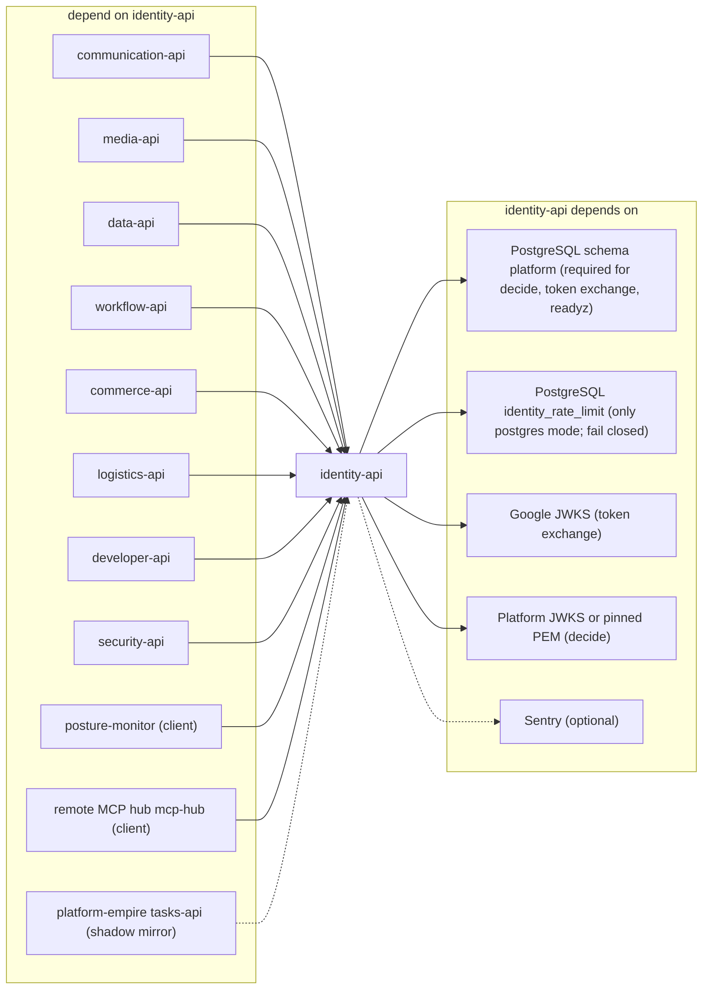

# 19 — Service dependency map (runtime)

Sources: `src/platform_identity/app.py`, `config.py`, `keys.py`, `google.py`, `rate_limit.py`, `_sentry.py`, `docs/PLATFORM-SERVICES-CUTOVER.md` (services trust issuer; posture-monitor), ops record: book-platforms-status (2026-11-03) (mcp-hub; JWT trust; payment audience)

## Failure impact

| If down | Effect (from code) |
|---|---|
| Platform PostgreSQL | decide → 503 `unavailable`; token exchange → 503; `/readyz` 503; **client_credentials still works** (no DB touch) unless postgres limiter shares that DB |
| Limiter DB (postgres mode) | every `/v1/token` → 503 `temporarily_unavailable` (no local fallback) |
| Google JWKS | first fetch fails → `invalid_grant`; after a good fetch, last good keys are kept |
| identity-api | services cannot verify new tokens once their JWKS cache expires; no new tokens issued |

Sources: `src/platform_identity/app.py` (`bound`, `readyz`, `token`), `src/platform_identity/keys.py` (`RemoteJwks._fetch`), `docs/SERVICE-CLIENTS.md`, `docs/SHARED-RATE-LIMIT.md`

## Open questions

- payment-api: ops record บอกว่ามี audience `payment-api` แล้วแต่ service ยังไม่ ready จึงไม่ได้วาด
- consumer JWKS cache TTL ใน platform-backend-core (กำหนดว่าทน identity ล่มได้นานแค่ไหน)
