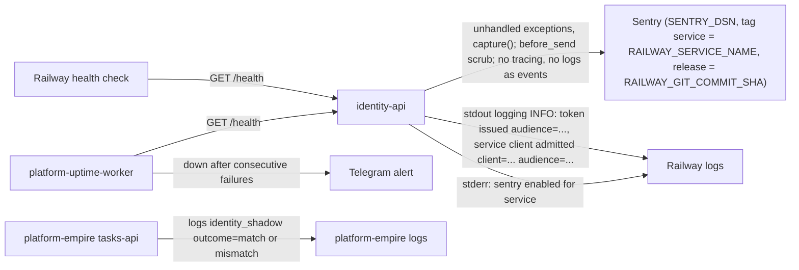

# 20 — Observability

Sources: `src/platform_identity/_sentry.py`, `src/platform_identity/app.py` (`log.info` lines, `logging.basicConfig`), `.railway/railway.ts`, `PRODUCT.md` (Success measures: uptime probe in `platform-uptime-worker` targets, Sentry live, shadow parity log), `README.md`; uptime → Telegram per central [ADR-0002](https://github.com/bookchaowalit/architecture-docs/blob/main/docs/architecture/decisions/ADR-0002-production-baseline-monitoring-backups.md)

## What is watched

| Signal | Source | Watched by | Target (`PRODUCT.md`) |
|---|---|---|---|
| Availability | `/health` | uptime worker, Railway | ≥ 99.5% monthly |
| Errors | Sentry | owner | no unresolved error before cutover |
| Shadow parity | `identity_shadow outcome=` in platform-empire | nobody automatically ("no report yet") | 100% match over 14 days |
| Token issuance volume | `token issued` / `service client admitted` log lines | not aggregated | — |
| Readiness | `/readyz` | manual after deploy | — |

ไม่มี metrics endpoint, tracing หรือ heartbeat ใน repo นี้; log ไม่พิมพ์ token, subject หรือ workspace (มีเฉพาะ audience และ client id)

## Open questions

- ชื่อ Sentry project ของ identity-api (ops record ระบุชื่อเฉพาะ 8 services อื่น)
- uptime worker probe `/health` (liveness เสมอ) ไม่ใช่ `/readyz`: DB ล่มจะไม่ถูกแจ้งเตือน
