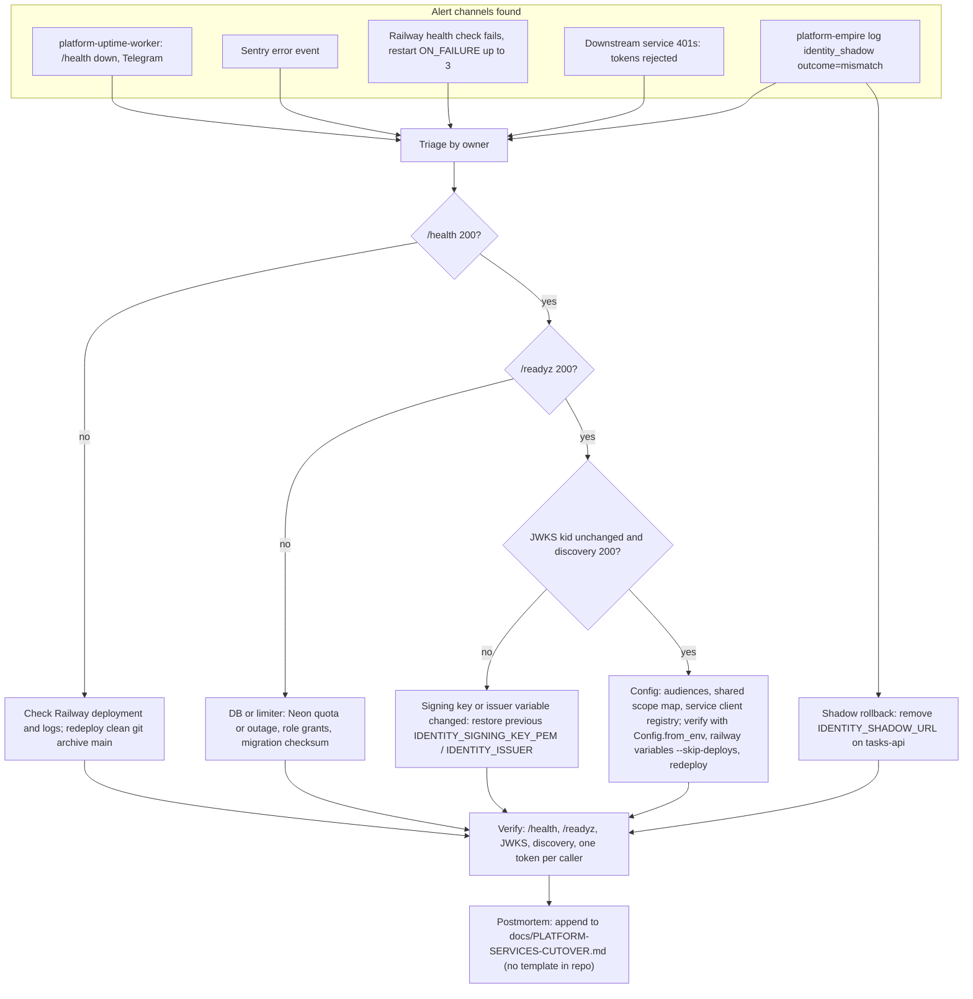

# 21 — Incident response

repo นี้ไม่มี RUNBOOK แยก; ขั้นตอน deploy/verify ที่ใช้จริงอยู่ใน [`docs/PLATFORM-SERVICES-CUTOVER.md`](../PLATFORM-SERVICES-CUTOVER.md) (reused) และ rollback ของขั้น 3 อยู่ใน [`docs/DESIGN-2026-10-13.md`](../DESIGN-2026-10-13.md) §7

Sources: `PRODUCT.md` (uptime probe, Sentry), `.railway/railway.ts`, `src/platform_identity/app.py` (`health`, `readyz`, `jwks`), `src/platform_identity/config.py`, `docs/PLATFORM-SERVICES-CUTOVER.md` (variable change + `Config.from_env` check + redeploy + checks), `docs/DESIGN-2026-10-13.md` ขั้น 3 rollback, `docs/SHARED-RATE-LIMIT.md` (readiness failure causes); Telegram per central [ADR-0002](https://github.com/bookchaowalit/architecture-docs/blob/main/docs/architecture/decisions/ADR-0002-production-baseline-monitoring-backups.md)

## Blast radius reminder

identity เป็น issuer ของ 8 Book Platform services ตั้งแต่ 2026-10-29 และเป็น token source ของ posture-monitor และ mcp-hub; incident ที่ทำให้ JWKS เปลี่ยนหรือ `/v1/token` ล่มกระทบทั้งหมด (ดู [19](19-service-dependency-map.md))

## Open questions

- ไม่มี severity levels, on-call หรือ postmortem template สำหรับ service นี้
- uptime probe ใช้ `/health` จึงไม่แจ้งเมื่อ DB ล่ม (ควร probe `/readyz` หรือไม่)
- rollback plan หลัง 8 services เชื่อ issuer นี้ (ลบ `IDENTITY_SHADOW_URL` ใช้ได้แค่กับ shadow)
