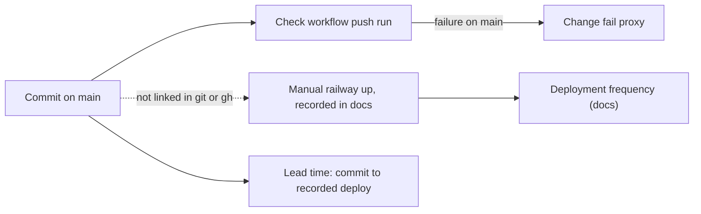

# 22 — DORA metrics

ช่วงวัด: 90 วัน **2026-08-05 → 2026-11-03** (วัดเมื่อ 2026-11-03 จาก worktree ที่ fetch `origin/main` = `9bf770c`)

**นิยาม deployment ของ repo นี้:** deploy เป็นมือด้วย `railway up` (Railway GitHub app ไม่ได้ติดตั้งใน org, CI ไม่ deploy) จึง **git/gh แสดง deployment ไม่ได้**: commit บน `main` ≠ deploy
ข้อมูล deploy ที่มีมาจาก docs ใน repo เท่านั้น (ตาราง Known deployments ใน [16-deployment.md](16-deployment.md)); ค่าที่ต้องการ Railway deployment history ระบุว่าคำนวณไม่ได้

| Metric | How measured here | Value (90 days) | Command |
|---|---|---|---|
| Deployment frequency | (a) production deploys recorded in repo docs; (b) proxy: first-parent commits on `main` | (a) **≥ 4 deploys** (2026-10-14, 2026-10-18, 2026-11-03 ×2) — lower bound, variable-only redeploys not recorded; (b) **27 commits on 10 distinct days** | (a) `grep -n "Deployed\|deployment\|build" docs/PLATFORM-SERVICES-CUTOVER.md docs/DESIGN-2026-10-13.md`; (b) `git log --first-parent --since=2026-08-05 --format='%ad' --date=short origin/main \| sort \| uniq -c` |
| Lead time for changes | commit time → recorded deploy | service clients (`fb52d6e`, merged 2026-10-29 20:46 +07) and shared admission (`754dc85`, 2026-10-29 00:35 +07) → deploy 2026-11-03 (before `6ad4bb9` 11:14 +07): **≈ 4.6 d and ≈ 5.4 d**; `6ad4bb9` → redeploy same day (recorded in `9bf770c` 17 min later). PR open → merge: 1–3 min (#2–#5) | `git log -1 --format='%h %aI' fb52d6e 754dc85 6ad4bb9 9bf770c`; `gh pr list -R bookchaowalit-backend/platform-identity --state all --json number,createdAt,mergedAt` |
| Change fail rate | (a) failed production deploys in docs; (b) proxy: `Check` push runs on `main` with `failure` | (a) **0 / ≥ 4** recorded (cannot confirm: no Railway history read); (b) **2 / 23 = 8.7 %** (`9c92a28`, `1e66b01`, 2026-10-13, repo rename) | `gh run list -R bookchaowalit-backend/platform-identity --workflow check.yml --branch main --event push --limit 200 --json conclusion` |
| Failed deployment recovery time | (a) production: cannot compute (no recorded failure, no Railway history); (b) proxy: red `Check` on `main` → next green | (b) **2 h 02 min** (`9c92a28` 03:35:47Z → `f2be016` 05:37:23Z, 2026-10-13) | `gh run list ... --json createdAt,headSha,conclusion` ordered by `createdAt` |
| Deployment rework rate | first-parent commits on `main` whose subject starts with `fix` or `revert` | **3 / 27 = 11.1 %** (`a9c01fd`, `41d420b`, `7e553f1`); PR #5 also carried `20bc844` "fix(token): harden service clients after security review" inside a merge | `git log --first-parent --since=2026-08-05 --format='%h %s' origin/main \| grep -E "^[0-9a-f]+ (fix\|revert\|Revert)"` |

Sources: `git log origin/main`, `gh run list -R bookchaowalit-backend/platform-identity` (35 runs, 23 push-on-main), `gh pr list` (5 PRs), `docs/PLATFORM-SERVICES-CUTOVER.md`, `docs/DESIGN-2026-10-13.md`, `.github/workflows/check.yml`, `PRODUCT.md`

## What git/gh can and cannot show

- **ได้:** commit cadence, CI result per commit, PR timings, fix/revert ratio
- **ไม่ได้:** วันที่และ commit ที่ deploy จริง, deploy ที่ล้ม, redeploy จากการเปลี่ยน variable (`railway variables --skip-deploys` + `railway redeploy`), rollback; ต้องใช้ `railway deployment list --service identity-api` (ไม่ได้รันในงานนี้)
- commit `05622c0`, `a9c01fd`, `3da9d01` มี timestamp เดียวกัน (push พร้อมกัน, CI run เดียว)

## Open questions

- จะบันทึก deploy แต่ละครั้ง (SHA, Railway deployment id, ผล verify) ไว้ที่ไหนเพื่อให้วัด DORA ได้: docs ใน repo, Railway history หรือ registry กลาง
- ต้องการ CD เพื่อให้ commit = deploy หรือไม่
